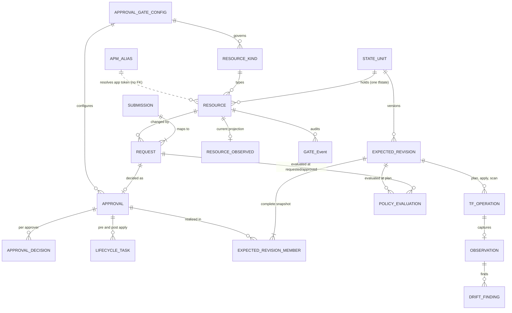

# ADR-GLB-004: Data Model and Centralized PostgreSQL Database (AlloyDB for PostgreSQL)

- **ADR ID:** ADR-GLB-004
- **Level:** global
- **Status:** Proposed
- **Owner:** Manoj (Shared Mailbox: `spp-architecture@tbd`, Named Owner: `Manoj`)
- **Signers:** Unsigned (Required Signers: Manoj [Architect], Dwayne [Approver], Norm [Approver], Karen [DBA/Operations])
- **Affected Repos:** `ssp-doc`, `ssp-cp`, `ssp-workers`, `ssp-ui`, `spp-factory-foundation`
- **Last Updated:** 2026-10-21

## Goal

Define the complete relational data model (schema `idp`: 18 tables, status vocabularies, SQL helper functions, immutability triggers, and read-model view `idp.v_resource_status`) and **AlloyDB for PostgreSQL** hosting architecture in GCP (`microdrive-dev`, region `us-east1`) that backs SPP's control plane (`ssp-cp`).

## Context

From the design session (`uploads/design-digest.md`), stakeholder overrides, and the reconstructed four-gate DDL (`specs/data-model/spp_state_model.sql`, transcribed from `idp_state_model.sql` and the diagrams PDF; see [`docs/source-provenance.md`](../../docs/source-provenance.md)):

1. **AlloyDB for PostgreSQL in `us-east1` (Overriding Cloud SQL):** Although the photographed `idp_state_model.sql` header mentioned `Cloud SQL for PostgreSQL`, SPP's locked decision overrides this: the control plane database (`spp_platform`) runs on a **dedicated Google Cloud AlloyDB for PostgreSQL** cluster/instance in `microdrive-dev` (`us-east1`), connected via private IP / Private Services Access (PSA) and IAM Workload Identity authentication. Every PostgreSQL 15+ construct in the DDL (`gen_random_uuid()`, `sha256()`, `convert_to()`, `plpgsql` triggers, `DEFERRABLE INITIALLY DEFERRED` foreign keys, `GIN (jsonb_path_ops)`, partial unique indexes, `GENERATED ALWAYS AS IDENTITY`, and `WITH (fillfactor = 80)`) is natively compatible with AlloyDB for PostgreSQL.
2. **Kind-Agnostic Shared Tables + JSONB Validated by Per-Kind JSON Schema:** At 5,000+ GCP projects, creating tables per resource kind or per project would require thousands of database objects to migrate per schema change. All tables in schema `idp` are shared across resource kinds (`gcs_bucket`, `spanner_instance`, `spanner_database`), keyed by `state_unit_id` and `resource_id`, while kind-specific payloads live in `jsonb` columns (`requested_spec`, `approved_spec`, `projection`) validated by versioned JSON Schemas pinned on `request.schema_version`.
3. **17 Captured DDL Tables + 18th Table (`idp.apm_alias`) from ER Diagram:** The README in the source bundle noted "17 tables" in `idp_state_model.sql`, while page 2 of the source diagrams PDF (`photos 6573-6575`) showed "All 18 tables in `idp` schema", adding `idp.apm_alias` under Registry as a lookup table with no foreign key (dashed line in ER diagram) used by the naming spec (`idp.apm_alias.alias for metadata.apm_id`, e.g., `apm0017299 -> orders`).
4. **DDL to Alembic Migration Path:** The canonical reconstructed DDL lives in [`specs/data-model/spp_state_model.sql`](../../specs/data-model/spp_state_model.sql) in `ssp-doc` and will be translated into versioned **Alembic** migrations in `ssp-cp`.

## Decision

### 1. Dedicated AlloyDB for PostgreSQL Hosting (`microdrive-dev` in `us-east1`)

- **Service & Nonprod Sizing:** Dedicated **Google Cloud AlloyDB for PostgreSQL** cluster and `BASIC` primary instance (`2 vCPU` / `16 GB`) in project `microdrive-dev`, region **`us-east1`**, logical database `spp_platform`, schema `idp` (alongside local auth tables `users` / `user_sessions` per `ADR-GLB-005`).
- **Backups, CMEK & Connectivity:** Continuous backup / PITR (14-day window in nonprod), CMEK key in `us-east1` (`projects/microdrive-dev/locations/us-east1/keyRings/<TODO>/cryptoKeys/<TODO>`), private IP / PSA only (no public IP), and GKE Workload Identity IAM database authentication (`roles/alloydb.client` + `roles/alloydb.databaseUser`).
- **Migrations:** Owned by `ssp-cp` via Alembic migrations derived from `specs/data-model/spp_state_model.sql`.

### 2. Entity-Relationship Model (`idp` Schema)

### 3. Complete Table & Column Catalog (`idp` Schema — 18 Tables + 1 View)

*(Items marked **Unverified (source gap)** correspond to `[NOT CAPTURED]` or `[truncated]` line ranges in the source photographs; see `## Open Questions` and `specs/data-model/spp_state_model.sql`.)*

| Gate / Category | Table / View | Primary Key & Uniqueness | Key Columns, Types & Constraints | Purpose |
| :--- | :--- | :--- | :--- | :--- |
| **Registry** | `idp.approval_gate_config` | `gate_key text PK` | `version integer NOT NULL DEFAULT 1 CHECK (version > 0)`, `config jsonb NOT NULL`, `enabled boolean NOT NULL DEFAULT true`, `updated_by text NOT NULL`, `updated_at timestamptz NOT NULL DEFAULT now()` | Human approval gate definitions (`order`, `self_approval`, `approvers[]`, `sla_days`, `escalation`, `max_wait_days`, `auto_close`). Pinned by `gate_key + version` (`ADR-BP-003`). |
| **Registry** | `idp.resource_kind` | `kind text PK`; `UNIQUE (cloud, tfvars_collection)` | `cloud text NOT NULL CHECK (cloud IN ('gcp'))` *(GCP-only override)*, `parent_kind text FK -> resource_kind(kind)`, `display_name text NOT NULL`, `schema_uri text NOT NULL`, `schema_version text NOT NULL`, `tf_module_source text NOT NULL`, `tfvars_collection text NOT NULL`, `tf_address_template text NOT NULL`, `opa_package text NOT NULL`, `approval_gate_key text FK -> approval_gate_config(gate_key)`, `drift_ignore_paths text[] NOT NULL DEFAULT '{}'`, `legacy_resource_type text`, `enabled boolean NOT NULL DEFAULT true`, `created_at timestamptz` | Per-kind registry (`gcs_bucket`, `spanner_instance`, `spanner_database`) (`ADR-GLB-009`). |
| **Registry** | `idp.apm_alias` | `apm_id text PK`; `UNIQUE (alias)` *(Unverified: DDL not captured in photos; inferred from ER diagram + `naming-spec.json`)* | `apm_id text PK CHECK (apm_id ~ '^apm[0-9]{7}$')`, `alias text NOT NULL UNIQUE CHECK (alias ~ '^[a-z][a-z0-9]{1,11}$')`, `app_tier text CHECK (app_tier IN ('1','2','3','4'))`, `created_at timestamptz` *(Unverified: exact columns beyond `apm_id` and `alias` not captured in SQL photos)* | Lookup table mapping `apm_id` (`apm0017299`) to short `app` naming token (`orders`). Shown in ER diagram with no FK (dashed line). |
| **Topology** | `idp.state_unit` | `state_unit_id uuid PK DEFAULT gen_random_uuid()`; `UNIQUE (cloud, scope_id)`; `UNIQUE (state_bucket, state_prefix)` | `cloud text NOT NULL CHECK (cloud IN ('gcp'))`, `scope_type text NOT NULL DEFAULT 'project' CHECK (scope_type IN ('project'))`, `scope_id text NOT NULL`, `lob text`, `environment text CHECK (environment IN ('nonprod', 'prod'))`, `apm_id text`, `state_bucket text NOT NULL DEFAULT 'microdrive-dev-spp-tfstate'`, `state_prefix text NOT NULL`, `executor_identity text NOT NULL`, `current_expected_rev integer`, `applied_expected_rev integer`, `status text NOT NULL DEFAULT 'active' CHECK (status IN ('active', 'frozen', 'decommissioning', 'retired'))`, `created_at`, `updated_at` *(Note: source lines 96–104 `[NOT CAPTURED]`; `scope_id`, `lob`, `apm_id`, `state_bucket`, `state_prefix`, `executor_identity` reconstructed from `v_resource_status` and column comments)* | One row per GCP project = one Terraform state file (`projects/<project_id>/default.tfstate` in `gs://microdrive-dev-spp-tfstate`). `status = 'frozen'` is the per-project kill switch (`INV-9`). |
| **Topology** | `idp.resource` | `resource_id uuid PK`; `resource_key text UNIQUE`; `UNIQUE (state_unit_id, kind, name)`; `UNIQUE (name) WHERE kind = 'gcs_bucket'` | `state_unit_id uuid NOT NULL FK`, `kind text NOT NULL FK`, `name text NOT NULL`, `parent_resource_id uuid FK -> resource(resource_id)`, `resource_key text NOT NULL UNIQUE`, `tf_address text NOT NULL`, `apm_id text NOT NULL CHECK (apm_id ~ '^apm[0-9]{7}$')`, `lifecycle text NOT NULL DEFAULT 'proposed'`, `gate text NOT NULL DEFAULT 'REQUESTED'`, `sync_status text NOT NULL DEFAULT 'PENDING'`, `current_request_id uuid DEFERRABLE FK`, `current_approval_id uuid DEFERRABLE FK`, `created_at`, `updated_at`, `deleted_at` | Stable identity of a managed resource across all requests. `apm_id` can differ from `state_unit.apm_id` (e.g., tenant database on shared DBaaS Spanner instance). |
| **Gate 1: Requested** | `idp.submission` | `submission_id uuid PK`; `UNIQUE (apm_id, idempotency_key)` | `channel text NOT NULL CHECK (channel IN ('ui', 'api', 'chat', 'legacy_shim', 'legacy_provisioning_shim', 'import'))`, `source_ref text`, `apm_id text NOT NULL CHECK (apm_id ~ '^apm[0-9]{7}$')`, `submitted_by text NOT NULL`, `on_behalf_of text`, `idempotency_key text NOT NULL`, `raw_payload jsonb NOT NULL`, `raw_payload_sha256 text NOT NULL CHECK (~ '^[0-9a-f]{64}$')`, `submitted_at timestamptz`, `CONSTRAINT submission_no_secret_values` | Verbatim business payload as received; kept for audit and re-mapping, never executed directly. |
| **Gate 1: Requested** | `idp.request` | `request_id uuid PK`; `temporal_workflow_id text UNIQUE` | `submission_id uuid NOT NULL FK`, `resource_id uuid NOT NULL FK`, `kind text NOT NULL FK`, `action text NOT NULL CHECK (action IN ('create', 'update', 'delete', 'import'))`, `schema_version text NOT NULL`, `requested_spec jsonb NOT NULL`, `requested_spec_sha256 text NOT NULL`, `source_pointer text`, `base_approval_id uuid FK -> approval(approval_id)`, `status text NOT NULL DEFAULT 'SUBMITTED'`, `status_reason text`, `temporal_workflow_id text UNIQUE`, `requested_by text NOT NULL`, `submitted_at`, `updated_at`, `CONSTRAINT request_no_secret_values` | One row per resource per change. Immutable (`request_guard` trigger). |
| **Gate 1/2/3: Policy** | `idp.policy_evaluation` | `evaluation_id uuid PK` *(inferred from FK in `idp.approval`; source lines 205–209 `[NOT CAPTURED]`)* | `stage text NOT NULL CHECK (stage IN ('requested', 'approved', 'plan'))`, `request_id uuid FK -> request(request_id)`, `revision_id uuid FK -> expected_revision(revision_id)`, `opa_package text NOT NULL`, `bundle_revision text NOT NULL`, `input_sha256 text NOT NULL`, `decision text NOT NULL CHECK (decision IN ('allow', 'deny', 'allow_with_mutations'))`, `violations jsonb NOT NULL DEFAULT '[]'`, `mutations jsonb NOT NULL DEFAULT '[]'`, `evaluated_at timestamptz`, `CONSTRAINT policy_evaluation_subject` | Records OPA evaluations at `requested`, `approved`, and `plan` stages, including guardrail mutations (`[{rule_id, op, path, value, reason}]`). |
| **Gate 2: Approved** | `idp.approval` | `approval_id uuid PK`; `request_id uuid NOT NULL UNIQUE FK` | `resource_id uuid NOT NULL FK`, `gate_key text FK -> approval_gate_config(gate_key)`, `gate_version integer`, `status text NOT NULL DEFAULT 'PENDING' CHECK (status IN ('PENDING', 'APPROVED', 'AUTO_APPROVED', 'DENIED', 'EXPIRED', 'REVOKED'))`, `approved_spec jsonb`, `approved_spec_sha256 text`, `guardrail_trace jsonb NOT NULL DEFAULT '[]'`, `policy_evaluation_id uuid FK`, `temporal_workflow_id text`, `decided_at timestamptz`, `valid_until timestamptz`, `created_at timestamptz`, `CONSTRAINT approval_spec_when_approved` *(Fields `approval_id`, `request_id`, `resource_id`, `gate_key`, `gate_version`, `status`, `approved_spec_sha256`, `guardrail_trace`, `temporal_workflow_id`, `decided_at`, `valid_until` confirmed by example rows in `gcs_bucket.gates.json` and `spanner.gates.json`; exact SQL `CHECK` in lines 250–258 inferred)* | The build contract: requested doc + enforced guardrails + `guardrail_trace` + approvals. Immutable once decided (`approval_guard` trigger). **Override:** `AUTO_APPROVED` is forbidden when `request.action = 'delete'`. |
| **Gate 2: Approved** | `idp.approval_decision` | `decision_id uuid PK`; `UNIQUE (approval_id, approver_key)` | `approval_id uuid NOT NULL FK`, `approver_key text NOT NULL`, `approver_identity text NOT NULL`, `phase integer NOT NULL DEFAULT 0 CHECK (phase >= 0)`, `mandatory boolean NOT NULL DEFAULT true`, `status text NOT NULL DEFAULT 'pending' CHECK (status IN ('pending', 'approved', 'denied', 'escalated', 'auto_approved', 'expired'))`, `sla_deadline timestamptz`, `follow_up_count integer NOT NULL DEFAULT 0`, `escalation_count integer NOT NULL DEFAULT 0`, `escalated_to text`, `responded_by text`, `response_comment text`, `requested_at`, `responded_at` | Per-approver decision state, SLA tracking, follow-ups, and manager escalation (`ADR-BP-003`). |
| **Gate 3: Expected** | `idp.expected_revision` | `revision_id uuid PK`; `UNIQUE (state_unit_id, revision_no)` *(Unverified: lines 302–309 `[NOT CAPTURED]` in SQL)* | `state_unit_id uuid NOT NULL FK`, `revision_no integer NOT NULL CHECK (revision_no > 0)`, `parent_revision_no integer`, `artifact_uri text NOT NULL`, `artifact_generation bigint NOT NULL`, `artifact_sha256 text NOT NULL`, `manifest jsonb NOT NULL`, `plan_uri text`, `plan_summary jsonb` (`{add, change, destroy, replace}`), `status text` *(Fields `revision_id`, `state_unit_id`, `revision_no`, `parent_revision_no`, `artifact_uri`, `artifact_generation`, `status` [`APPLIED`], and `plan_summary` [`{add, change, destroy, replace}`] confirmed by example rows in `gcs_bucket.gates.json` and `spanner.gates.json`; SQL types/constraints in lines 302–309 inferred)*, `blocked_reason text` (`destroy_without_delete_request`, `approved_hash_mismatch`, `prerequisite_failed`), `created_at timestamptz` | Immutable snapshot of the desired state of one state unit (`expected_revision_guard` trigger). |
| **Gate 3: Expected** | `idp.expected_revision_member` | `PRIMARY KEY (revision_id, resource_id)` | `revision_id uuid NOT NULL FK`, `resource_id uuid NOT NULL FK`, `approval_id uuid NOT NULL FK`, `change text NOT NULL CHECK (change IN ('unchanged', 'added', 'modified', 'removed'))`, `tf_address text NOT NULL` | Complete membership snapshot: every active resource in the state unit appears in every revision, including `unchanged` ones. |
| **Gate 3: Expected** | `idp.tf_operation` | `operation_id text PK`; `k8s_job_name text NOT NULL UNIQUE`; `UNIQUE (revision_id, phase, run_key)` | `state_unit_id uuid NOT NULL FK`, `revision_id uuid NOT NULL FK`, `phase text NOT NULL CHECK (phase IN ('plan', 'apply', 'refresh_plan', 'destroy_plan', 'import'))`, `run_key text NOT NULL DEFAULT '1'`, `k8s_namespace text NOT NULL`, `k8s_job_name text NOT NULL UNIQUE`, `executor_identity text NOT NULL`, `temporal_workflow_id text NOT NULL`, `temporal_activity_id text`, `status text NOT NULL DEFAULT 'PENDING' CHECK (status IN ('PENDING', 'RUNNING', 'SUCCEEDED', 'FAILED', 'CANCELLED'))`, `tf_exit_code integer CHECK (tf_exit_code IN (0, 1, 2))`, `state_serial_before bigint`, `state_serial_after bigint`, `state_lineage text`, `logs_uri text`, `error jsonb`, `created_at`, `started_at`, `finished_at`, `CONSTRAINT tf_operation_id_format`, `CONSTRAINT tf_operation_job_name_derived`, `CONSTRAINT tf_operation_job_name_len` *(Tail fields `tf_exit_code`, `state_serial_before`, `state_serial_after`, `state_lineage`, `logs_uri`, `started_at`, `finished_at` and phases `plan`, `apply`, `refresh_plan` confirmed by example rows in `gcs_bucket.gates.json`)* | Tracks one Terraform Kubernetes Job per run (`INV-7`). Enforces `k8s_job_name = idp.k8s_job_name(operation_id, phase)` and `length(k8s_job_name) <= 63`. |
| **Gate 4: Observed** | `idp.observation` | `observation_id uuid PK` | `state_unit_id uuid NOT NULL FK`, `source text NOT NULL CHECK (source IN ('post_apply', 'refresh_plan', 'asset_inventory', 'import'))`, `operation_id text FK -> tf_operation(operation_id)`, `revision_id uuid FK -> expected_revision(revision_id)`, `state_uri text NOT NULL`, `state_generation bigint`, `state_serial bigint`, `state_lineage text`, `snapshot_uri text`, `drift_detected boolean`, `captured_at timestamptz NOT NULL DEFAULT now()` | Narrow pointer row per capture of a state unit (~5,000 rows/day for 5,000 projects scanned daily). |
| **Gate 4: Observed** | `idp.resource_observed` | `resource_id uuid PK FK -> resource(resource_id)` | `changed_in_observation_id uuid NOT NULL FK -> observation(observation_id)`, `exists_in_cloud boolean NOT NULL`, `cloud_resource_id text`, `projection jsonb NOT NULL`, `projection_sha256 text NOT NULL`, `changed_at timestamptz NOT NULL`, `CONSTRAINT resource_observed_projection_small CHECK (octet_length(projection::text) < 2000)` `WITH (fillfactor = 80)` | Small (`< 2000` bytes), non-sensitive subset of Observed values keyed like the Expected entry. Upserted only when `projection_sha256` changes. |
| **Gate 4: Observed** | `idp.drift_finding` | `drift_id uuid PK`; `UNIQUE (resource_id, attribute_path) WHERE status IN ('OPEN', 'ACKNOWLEDGED')` | `resource_id uuid NOT NULL FK`, `observation_id uuid NOT NULL FK`, `revision_id uuid NOT NULL FK`, `drift_kind text NOT NULL CHECK (drift_kind IN ('out_of_band_change', 'config_divergence', 'missing_in_cloud', 'unmanaged_in_cloud'))`, `attribute_path text NOT NULL`, `expected_value jsonb`, `observed_value jsonb`, `severity text NOT NULL CHECK (severity IN ('critical', 'high', 'medium', 'low'))` *(Columns `drift_id`, `resource_id`, `observation_id`, `revision_id`, `drift_kind`, `attribute_path`, `expected_value`, `observed_value`, `severity`, `guardrail_rule_id`, `status`, `detected_at` confirmed by example rows in `gcs_bucket.gates.json` and `spanner.gates.json`; SQL types/constraints in lines 408–411 inferred)*, `guardrail_rule_id text`, `status text NOT NULL DEFAULT 'OPEN' CHECK (status IN ('OPEN', 'ACKNOWLEDGED', 'RESOLVED', 'ACCEPTED'))`, `resolution text CHECK (resolution IN ('spec_updated', 'accepted_risk', 'resource_deleted'))` *(Override: `REMEDIATING` and `'reapplied'` removed per alert-only drift rule)*, `detected_at`, `resolved_at` | One row per differing JSON-pointer attribute between `Expected` and `Observed`. Alert-only (`ADR-AUT-002`). |
| **Cross-Cutting** | `idp.lifecycle_task` | `task_id uuid PK`; `UNIQUE (approval_id, task_key)` | `resource_id uuid NOT NULL FK`, `approval_id uuid NOT NULL FK`, `phase text NOT NULL CHECK (phase IN ('pre_apply', 'post_apply'))`, `task_type text NOT NULL CHECK (task_type IN ('ad_group', 'vpc_sc_ingress', 'vpc_sc_project_membership', 'enable_service', 'dataportal_register', 'cmdb_register', 'notify_owner', 'backup_enroll'))`, `task_key text NOT NULL` (`<task_type>:<target>`), `spec jsonb NOT NULL DEFAULT '{}'`, `status text NOT NULL DEFAULT 'PENDING' CHECK (status IN ('PENDING', 'RUNNING', 'SUCCEEDED', 'FAILED', 'SKIPPED'))`, `external_ref text`, `attempts integer NOT NULL DEFAULT 0`, `last_error text`, `updated_at timestamptz` | Materialized pre-apply prerequisites and post-apply bootstrap tasks derived from `approved_spec`. |
| **Cross-Cutting** | `idp.gate_event` | `event_id bigint GENERATED ALWAYS AS IDENTITY PK` | `occurred_at timestamptz NOT NULL DEFAULT now()`, `state_unit_id uuid FK`, `resource_id uuid FK`, `request_id uuid FK`, `gate text NOT NULL CHECK (gate IN ('REQUESTED', 'APPROVED', 'EXPECTED', 'OBSERVED'))`, `event_type text NOT NULL`, `actor text NOT NULL` (`user:<email>` or `system:<workflow_id>`), `detail jsonb NOT NULL DEFAULT '{}'`, `published_at timestamptz` *(lines 460–461 `[NOT CAPTURED]`)* | Append-only audit trail and transactional outbox (`gate_event_guard` trigger prevents `DELETE` and any `UPDATE` except setting `published_at`). |
| **Read Model** | `idp.v_resource_status` | View (1 row per `idp.resource`) | Joins `idp.resource`, `idp.state_unit`, `idp.request` (`current_request_id`), `idp.approval` (`current_approval_id`), latest `idp.expected_revision` via `LATERAL` on `idp.expected_revision_member`, `idp.resource_observed`, and open `idp.drift_finding` count | Single-row status summary across all four gates for UI and API queries. |

### 4. Status Vocabularies & Casing Convention

Status vocabularies are implemented as PostgreSQL `CHECK` constraints rather than `ENUM` types so they can evolve without type migrations. Convention: **`UPPER_SNAKE_CASE` for platform state**, **`lowercase` for approver decisions** (and topology lifecycle/state_unit status):

- `request.status`: `SUBMITTED`, `INVALID`, `PENDING_APPROVAL`, `APPROVED`, `DENIED`, `EXPIRED`, `CANCELLED`, `SUPERSEDED`
- `approval.status`: `PENDING`, `APPROVED`, `AUTO_APPROVED`, `DENIED`, `EXPIRED`, `REVOKED` *(Note: `AUTO_APPROVED` is forbidden for `delete` actions or plans with `destroy > 0` / `replace > 0`)*
- `approval_decision.status`: `pending`, `approved`, `denied`, `escalated`, `auto_approved`, `expired` *(Note: `auto_approved` is forbidden for `delete` actions)*
- `resource.lifecycle`: `proposed`, `active`, `deleting`, `deleted`, `abandoned`
- `resource.gate`: `REQUESTED`, `APPROVED`, `EXPECTED`, `OBSERVED`
- `resource.sync_status`: `PENDING`, `IN_SYNC`, `DRIFTED`, `FAILED`, `UNKNOWN`
- `state_unit.status`: `active`, `frozen`, `decommissioning`, `retired`
- `tf_operation.status`: `PENDING`, `RUNNING`, `SUCCEEDED`, `FAILED`, `CANCELLED`; `tf_exit_code`: `0`, `1`, `2`; `phase`: `plan`, `apply`, `refresh_plan`, `destroy_plan`, `import`
- `expected_revision.status`: `RENDERED`, `PLANNED`, `BLOCKED`, `APPLYING`, `APPLIED`, `FAILED`, `SUPERSEDED` *(Unverified: exact `CHECK` list in DDL lines 302–309 was `[NOT CAPTURED]`; `APPLIED` and `BLOCKED` are confirmed from examples and `INV-4`)*
- `drift_finding.status`: `OPEN`, `ACKNOWLEDGED`, `RESOLVED`, `ACCEPTED` *(Override: `REMEDIATING` removed because drift is alert-only)*; `resolution`: `spec_updated`, `accepted_risk`, `resource_deleted` *(Override: `reapplied` removed; remediation requires a new approved request)*; `drift_kind`: `out_of_band_change`, `config_divergence`, `missing_in_cloud`, `unmanaged_in_cloud`; `severity`: `critical`, `high`, `medium`, `low`
- `lifecycle_task.status`: `PENDING`, `RUNNING`, `SUCCEEDED`, `FAILED`, `SKIPPED`
- `policy_evaluation.decision`: `allow`, `deny`, `allow_with_mutations`; `stage`: `requested`, `approved`, `plan`

### 5. Database Triggers, Functions, and Worker Reference Statements

1. **`idp.k8s_job_name(p_operation_id text, p_phase text)`:** SQL `IMMUTABLE PARALLEL SAFE` function returning `'tf-' || replace(p_phase, '_', '-') || '-' || substr(encode(sha256(convert_to(p_operation_id, 'UTF8')), 'hex'), 1, 20)`. Enforced by `CONSTRAINT tf_operation_job_name_derived CHECK (k8s_job_name = idp.k8s_job_name(operation_id, phase))`.
2. **Immutability Triggers:**
   - `idp.request_guard()` (`BEFORE UPDATE ON idp.request`): Raises exception if `requested_spec`, `requested_spec_sha256`, `action`, `kind`, `resource_id`, `submission_id`, or `schema_version` is modified.
   - `idp.approval_guard()` (`BEFORE UPDATE ON idp.approval`): Once `OLD.status <> 'PENDING'`, raises exception if `approved_spec`, `approved_spec_sha256`, `guardrail_trace`, or `request_id` changes, or if `status` transitions to anything other than `APPROVED`/`AUTO_APPROVED` → `REVOKED`/`EXPIRED`.
   - `idp.expected_revision_guard()` (`BEFORE UPDATE ON idp.expected_revision`): Raises exception if `artifact_uri`, `artifact_generation`, `artifact_sha256`, `manifest`, `revision_no`, or `state_unit_id` changes.
   - `idp.gate_event_guard()` (`BEFORE UPDATE OR DELETE ON idp.gate_event`): Raises exception on `DELETE` or any `UPDATE` touching columns other than `published_at`.
3. **Optimistic Concurrency & Idempotent Upsert Statements:**
   - Advancing `state_unit.current_expected_rev`: `UPDATE idp.state_unit SET current_expected_rev = :new_rev WHERE state_unit_id = :state_unit_id AND current_expected_rev IS NOT DISTINCT FROM :prev_rev;` (`0` rows updated = lost the race, re-compose).
   - Upserting `idp.resource_observed`: `INSERT INTO idp.resource_observed AS ro (...) VALUES (...) ON CONFLICT (resource_id) DO UPDATE SET ... WHERE ro.projection_sha256 IS DISTINCT FROM EXCLUDED.projection_sha256;`

## Requirements

- **REQ-1 (MUST):** The SPP control plane (`ssp-cp`) MUST persist all four-gate relational data in a dedicated **AlloyDB for PostgreSQL** cluster/instance (`spp_platform` database, schema `idp`, in `microdrive-dev`, region `us-east1`), connected via private IP / PSA and GKE Workload Identity IAM auth.
- **REQ-2 (MUST):** `ssp-cp` MUST translate [`specs/data-model/spp_state_model.sql`](../../specs/data-model/spp_state_model.sql) into versioned **Alembic** migrations creating all 18 tables (`approval_gate_config`, `resource_kind`, `apm_alias`, `state_unit`, `resource`, `submission`, `request`, `policy_evaluation`, `approval`, `approval_decision`, `expected_revision`, `expected_revision_member`, `tf_operation`, `observation`, `resource_observed`, `drift_finding`, `lifecycle_task`, `gate_event`) and `v_resource_status`.
- **REQ-3 (MUST):** `submission.raw_payload` and `request.requested_spec` MUST enforce both JSON Schema validation and database `CHECK` constraints (`submission_no_secret_values`, `request_no_secret_values`) rejecting secret keys (`password`, `passwd`, `client_secret`, `private_key`, `secret_value`, `api_key`, `token`).
- **REQ-4 (MUST):** `idp.submission` MUST enforce `UNIQUE (apm_id, idempotency_key)` so retried intake submissions are deduplicated deterministically.
- **REQ-5 (MUST):** Database triggers (`request_guard`, `approval_guard`, `expected_revision_guard`, `gate_event_guard`) MUST enforce append-only / immutable semantics on `idp.request`, decided `idp.approval`, `idp.expected_revision` artifact fields, and `idp.gate_event`.
- **REQ-6 (MUST):** `idp.resource_observed` MUST enforce `CHECK (octet_length(projection::text) < 2000)` and `WITH (fillfactor = 80)` and MUST only update rows when `projection_sha256` changes.
- **REQ-7 (MUST):** All `cloud` columns (`idp.resource_kind.cloud`, `idp.state_unit.cloud`) MUST constrain `CHECK (cloud IN ('gcp'))` for the GCP-only scope.

## Guardrails

- **GR-1:** Do not use Cloud SQL, do not share the in-cluster PostgreSQL in `spp-temporal` or `spp-factory`, and do not deploy a PostgreSQL StatefulSet in `spp-platform`; use dedicated AlloyDB for PostgreSQL in `us-east1`.
- **GR-2:** Never create per-kind or per-project tables in AlloyDB; all resource kinds share the `idp` tables with kind-specific payloads validated by JSON Schema.
- **GR-3:** Never store full Terraform `.tfstate`, `plan.json`, or `terraform.tfvars.json` blobs in AlloyDB; `resource_observed.projection` must remain `< 2000` bytes and free of `sensitive_values`.
- **GR-4:** Never allow `AUTO_APPROVED` in `idp.approval` or `auto_approved` in `idp.approval_decision` when `request.action = 'delete'` or when a plan has `destroy > 0` or `replace > 0`.

## Consequences

### Positive

- Single kind-agnostic relational schema scales cleanly across 5,000+ GCP projects and hundreds of resource kinds without DDL migrations per resource kind.
- Database-level `CHECK` constraints and `plpgsql` triggers enforce immutability, secret-key rejection, `< 2 KB` projection caps, and deterministic Kubernetes Job naming (`idp.k8s_job_name`) even if application code has a bug.
- `idp.v_resource_status` provides a fast, single-query read model across all four gates.

### Negative / Trade-offs

- Several line ranges in the photographed `idp_state_model.sql` were not captured on camera and are tracked explicitly as **Unverified (source gap)** in `specs/data-model/spp_state_model.sql` and `## Open Questions` below so `ssp-cp` engineers can confirm exact column definitions before freezing the initial Alembic migration.

## Acceptance Criteria

- [ ] `specs/data-model/spp_state_model.sql` is committed in `ssp-doc` with AlloyDB compatibility, `us-east1` / `nonprod` / `gs://microdrive-dev-spp-tfstate` overrides applied, and all `[NOT CAPTURED]` gaps preserved and flagged.
- [ ] `ssp-cp` converts `specs/data-model/spp_state_model.sql` into Alembic migrations targeting AlloyDB `spp_platform`.
- [ ] Automated tests in `ssp-cp` verify `request_guard`, `approval_guard`, `expected_revision_guard`, `gate_event_guard`, `submission_no_secret_values`, and `resource_observed_projection_small`.

## Success Criteria

- **SC-1:**
  - **Given** `specs/data-model/spp_state_model.sql` executed against an AlloyDB for PostgreSQL (`PostgreSQL 15+`) database
  - **When** the DDL and seed statements run inside `BEGIN ... COMMIT`
  - **Then** all tables, functions, triggers, indexes, views, and seed rows in schema `idp` are created without error.
- **SC-2:**
  - **Given** a decided row in `idp.approval` (`status = 'APPROVED'`) or an existing row in `idp.request`
  - **When** any caller attempts an `UPDATE` modifying `approved_spec` or `requested_spec`, or attempts a `DELETE` on `idp.gate_event`
  - **Then** AlloyDB aborts the statement with the trigger exception from `approval_guard`, `request_guard`, or `gate_event_guard`.

## Affected Repos

| Repository | Impact Summary |
| :--- | :--- |
| `ssp-doc` | Defines `ADR-GLB-004` and the reconstructed DDL in `specs/data-model/spp_state_model.sql` |
| `ssp-cp` | Translates `specs/data-model/spp_state_model.sql` into SQLAlchemy models and Alembic migrations on AlloyDB `spp_platform` |
| `ssp-workers` | Reads/writes `expected_revision`, `tf_operation`, `observation`, `resource_observed`, `drift_finding`, `lifecycle_task`, and `gate_event` |
| `ssp-ui` | Queries `idp.v_resource_status` and `idp.drift_finding` via `ssp-cp` APIs |
| `spp-factory-foundation` | Validates example rows and hash chains against the `idp` data model |

## Open Questions

- [x] **OQ-1 (AlloyDB vs. Cloud SQL — OVERRIDDEN BY USER DECISION 2026-10-21):** *Resolved:* Use **AlloyDB for PostgreSQL** in `microdrive-dev` (`us-east1`), overriding the source DDL header's reference to Cloud SQL.
- [ ] **OQ-2 (Source Gaps in `idp_state_model.sql` — UNVERIFIED SOURCE GAP [Owner: Manoj / Karen]):** **Unverified (source gap):** The following line ranges of `idp_state_model.sql` were not photographed (`[NOT CAPTURED]` / `[truncated]`) and are reconstructed with explicit markers in `specs/data-model/spp_state_model.sql`:
  1. **Lines 47–52:** Comment/header block preceding `idp.approval_gate_config`.
  2. **Lines 96–104 (`idp.state_unit`):** Exact definitions and nullability of `scope_type`, `scope_id`, `lob`, `environment`, `apm_id`, `state_bucket`, `state_prefix`, `executor_identity` (inferred from `UNIQUE (cloud, scope_id)`, `UNIQUE (state_bucket, state_prefix)`, column comments, and `idp.v_resource_status`).
  3. **Line 148 & Lines 149–156 (`idp.resource`):** Tail of `CREATE UNIQUE INDEX resource_gcs_bucket_name_uq ON idp.resource (name)` (inferred `WHERE kind = 'gcs_bucket'`) and any additional indexes/comments on `idp.resource`.
  4. **Lines 205–209 (`idp.policy_evaluation`):** Table header and `evaluation_id uuid PRIMARY KEY DEFAULT gen_random_uuid()` (inferred from FK in `idp.approval`).
  5. **Lines 250–258 (`idp.approval`):** Example rows in `gcs_bucket.gates.json` and `spanner.gates.json` confirm the `approval` row fields (`approval_id`, `request_id`, `resource_id`, `gate_key`, `gate_version`, `status`, `approved_spec_sha256`, `guardrail_trace`, `temporal_workflow_id`, `decided_at`, `valid_until`); the exact SQL `CHECK` expression in `CONSTRAINT approval_spec_when_approved` (inferred as `OR (approved_spec IS NOT NULL AND approved_spec_sha256 IS NOT NULL)`) was not captured in the SQL photos.
  6. **Lines 302–309 (`idp.expected_revision`):** Example rows in `gcs_bucket.gates.json` and `spanner.gates.json` confirm the tail fields (`artifact_uri`, `artifact_generation`, `status` [`'APPLIED'`], `plan_summary` [`{add, change, destroy, replace}`]); the exact SQL column types, full `status` `CHECK` list, `blocked_reason text`, and `UNIQUE (state_unit_id, revision_no)` in lines 302–309 are inferred.
  7. **Lines 356–362 (`idp.tf_operation`):** Example rows in `gcs_bucket.gates.json` confirm the `tf_operation` tail fields (`tf_exit_code`, `state_serial_before`, `state_serial_after`, `state_lineage`, `logs_uri`, `started_at`, `finished_at`) and phases (`plan`, `apply`, `refresh_plan`); any additional indexes/comments in SQL lines 356–362 were not captured.
  8. **Lines 408–411 (`idp.drift_finding`):** Example rows in `gcs_bucket.gates.json` and `spanner.gates.json` confirm the columns (`drift_id`, `resource_id`, `observation_id`, `revision_id`, `drift_kind`, `attribute_path`, `expected_value`, `observed_value`, `severity`, `guardrail_rule_id`, `status`, `detected_at`); exact SQL column types and `CHECK` constraints in lines 408–411 are inferred (`attribute_path text NOT NULL`, `expected_value jsonb`, `observed_value jsonb`, `severity text NOT NULL`).
  9. **Lines 460–461 (`idp.gate_event`):** Tail of `idp.gate_event` including `published_at timestamptz`.
  10. **Lines 602 & 605 (`idp.v_resource_status`):** `LEFT JOIN idp.approval ap ON ap.approval_id = r.current_approval_id` and `FROM idp.expected_revision_member m`.
  11. **Lines 649–652 (`idp.resource_kind` seed):** In the `gcs_bucket` seed row, `tfvars_collection = 'gcs_buckets'` and `tf_address_template = 'module.gcs_bucket["{name}"]'` are now confirmed by `examples/gcs_bucket.gates.json` (and the tail `ARRAY['/force_destroy'], 'storage-bucket'` was visible in the SQL photo); `display_name`, `schema_uri`, `tf_module_source`, and `opa_package` remain inferred.
  12. **`idp.apm_alias` DDL:** Shown as the 18th table on page 2 of the diagrams PDF (`photos 6573-6575`) and referenced in `naming-spec.json` (`idp.apm_alias.alias for metadata.apm_id`), but not present in the captured `idp_state_model.sql` photos.

## Related ADRs

- [ADR-GLB-002: Languages and Technology Stack](ADR-GLB-002-languages-and-technology-stack.md)
- [ADR-GLB-003: Four-Gate Provisioning State Model and Storage Layout](ADR-GLB-003-four-state-model.md)
- [ADR-GLB-005: Identity, Workload Identity, and Authentication](ADR-GLB-005-identity-and-authentication.md)
- [ADR-GLB-009: Resource Kind Registry](ADR-GLB-009-resource-kind-registry.md)
- [ADR-BP-003: Roles, Personas, and Approval Gate Governance](../business-process/ADR-BP-003-roles-and-approver-governance.md)
- [ADR-CLD-GCP-001: Runtime Platform (GKE `md-dev` and Self-Hosted Temporal)](../per-cloud/gcp/ADR-CLD-GCP-001-runtime-platform-gke-and-temporal.md)
