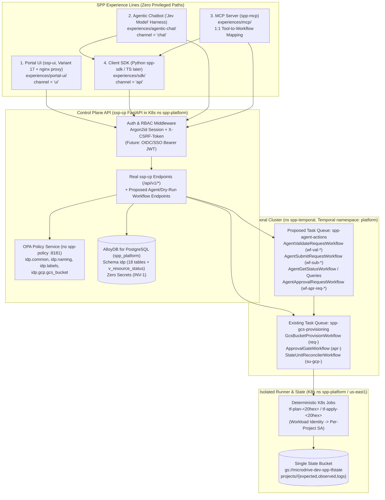

# SPP Experience Lines (`experiences/`)

This directory defines the user- and automation-facing **experience lines** for the **Self-Service Provisioning Platform (SPP)** on **Google Cloud Platform (GCP)** (`us-east1`, environments `nonprod` and `prod` only). Every experience line starts with the **first vertical slice: Google Cloud Storage Bucket (`kind = "gcs_bucket"`, `ADR-SVC-001`)**.

---

## 1. Shared Architectural Principle: One Control Plane, Zero Privileged Channels

Across SPP, **every channel is a thin client over the same `ssp-cp` FastAPI Control Plane API, the same deterministic Temporal workflows on namespace `platform`, the same OPA/Rego policy gates (`requested`, `approved`, `plan`), and the same human approval gate (`gcs_bucket_owner` v1)**:

1. **No Privileged or Backdoor Path:** Neither the Portal UI (`ssp-ui`), the Agentic Chatbot ("Jev model" assistant), the MCP Server, nor the Client SDK ever connects directly to AlloyDB (`spp_platform`), the OPA sidecar (`http://spp-opa.spp-policy.svc.cluster.local:8181`), the Temporal frontend (`temporal-frontend.spp-temporal.svc.cluster.local:7233`), or the GCS state bucket (`gs://microdrive-dev-spp-tfstate`).
2. **Deterministic Temporal Execution Layer (`ADR-AUT-004`):** Agents and MCP tools never perform side effects directly. The LLM / agent emits **intent + typed parameters only**; every action (`validate`, `submit`, `status`, `plan retrieval`, `approval requests`) is executed as a deterministic Temporal workflow on Temporal namespace `platform` (with existing GCS provisioning on task queue `spp-gcs-provisioning` via `GcsBucketProvisionWorkflow` and agent-facing orchestration proposed on task queue `spp-agent-actions`) invoked through the `ssp-cp` REST API with explicit `idempotency_key`s, returning deterministic `workflow_id`s to the conversation and supporting Temporal queries/signals for status.
3. **Caller Identity Propagation:** Every channel authenticates as the human or authorized service principal (`ADR-GLB-005`) and propagates the caller's identity (`requested_by`, `submitted_by`, `on_behalf_of`) and `channel` (`ui`, `chat`, `api`) into `idp.submission`, `idp.gate_event`, and `idp.cp_audit_log`.
4. **Identical GCS Bucket Schema & Guardrails (`ADR-SVC-001`, `ADR-GLB-006..008`):**
   - **APM ID:** Matches `(?i)^APM\d{5}$` on intake (e.g., `APM12345`) and normalizes to lowercase `^apm\d{5}$` (`apm12345`) in `metadata.apm_id` and the `sppappid` label (`NAM-APM-001`).
   - **Environment:** Normalizes legacy codes (`sandbox`, `dev`, `qa`, `test`, `pdev`, `pqa`, `preprod`) to `nonprod` (no hyphen) or `prod` (`GLB-ENV-001`); `environmentsubtype` is dropped and forbidden everywhere.
   - **8 Mandatory Labels (`LBL-001` & `LBL-002`):** `sppappid`, `costcenter`, `environmenttype` (`nonprod` | `prod`), `primarylob`, `datasensitivity`, `owner`, `provisionedby` (`"idp"`), and `idp_resource_id` (plus metadata-derived `dataclassification`, `sharedemailaddress`, `tenancy`).
   - **CMEK Key (`GCS-ENC-001`):** `projects/microdrive-dev/locations/us-east1/keyRings/spp-keyring/cryptoKeys/spp-gcs-cmek` in `us-east1` (`location = "us-east1"` only).
   - **Guardrail Trace (`stage = 'approved'`):** `GCS-UBLA-001` (`true`), `GCS-PAP-001` (`"enforced"`), `GCS-ENC-001`, `GCS-RET-001` (`90` days), `GCS-RET-003` (`retention_locked = false`), `GCS-SDP-001` (`7` days), `GCS-DEL-001` (`force_destroy = false`), `LBL-001`, `PRQ-001` (`ad_group`), and `PRQ-002` (`vpc_sc_ingress`).
5. **Non-Bypassable Human Approvals & Universal No-Delete Rule (`ADR-BP-003`, `ADR-GLB-007`):**
   - Every `gcs_bucket` request requires human approval via `gcs_bucket_owner` v1 (`bucket_owner` resolved from `/metadata/owner`).
   - Self-approval is strictly denied (`self_approval = "deny"`).
   - No deletion (`action = "delete"`), destroy, or replacement (`destroy > 0` or `replace > 0`) may ever be auto-approved (`AUTO_APPROVED` / `auto_approved` is forbidden) in **any** environment (`nonprod` or `prod`).

---

## 2. Experience Lines Matrix

| Experience Line | Folder | Governing ADR(s) | Submission `channel` | Primary Persona(s) | First Feature Covered | Summary |
| :--- | :--- | :--- | :--- | :--- | :--- | :--- |
| **1. Portal UI Experience (`ssp-ui`)** *(live at `https://portal.taxi.growripple.ai`)* | [`portal-ui/`](portal-ui/) ([`README.md`](portal-ui/README.md), [`16-ui-spec.md`](portal-ui/16-ui-spec.md), [`44-ssp-ui-structure.md`](portal-ui/44-ssp-ui-structure.md)) | [`ADR-EXP-004`](../adr/experience/ADR-EXP-004-portal-ui-experience.md), [`ADR-GLB-002`](../adr/global/ADR-GLB-002-languages-and-technology-stack.md), [`ADR-BP-002`](../adr/business-process/ADR-BP-002-build-order-and-phasing.md) | `ui` | Developer (`requester`), `bucket_owner`, `approver`, `architect`, `operations` | `gcs_bucket` (`ADR-SVC-001` **LIVE**; Spanner **Coming Soon**) | Live IDP Design Variant 17 React + TypeScript storefront (`https://portal.taxi.growripple.ai`) served behind an nginx reverse proxy to `spp-cp` (`ssp-cp`) -> OPA intake policy -> human approval -> Temporal workflow (`GcsBucketProvisionWorkflow`) -> Terraform plan -> apply gate. |
| **2. Agentic Chatbot Experience ("Jev Model" Assistant)** | [`agentic-chat/`](agentic-chat/) ([`README.md`](agentic-chat/README.md), [`agent-harness.md`](agentic-chat/agent-harness.md)) | [`ADR-EXP-001`](../adr/experience/ADR-EXP-001-agentic-chatbot-experience.md), [`ADR-AUT-004`](../adr/automation/ADR-AUT-004-agent-harness-and-temporal-workflow-execution.md) | `chat` | Developer (`requester`), `bucket_owner`, `approver` | `gcs_bucket` (`ADR-SVC-001`) | Conversational agent governed by the **Jev model Agent Harness**: gathers GCS bucket parameters via chat, outputs strictly intent + typed parameters, invokes deterministic Temporal workflows (`platform` namespace) via `ssp-cp` on the user's behalf, renders OPA policy results, `guardrail_trace`, and Terraform plan summaries, and enforces human-in-the-loop checkpoints without ever bypassing human approval gates. |
| **3. MCP Server Experience** | [`mcp/`](mcp/) ([`README.md`](mcp/README.md)) | [`ADR-EXP-002`](../adr/experience/ADR-EXP-002-mcp-server-experience.md), [`ADR-AUT-004`](../adr/automation/ADR-AUT-004-agent-harness-and-temporal-workflow-execution.md) | `chat` or `api` (`source_ref = "mcp:2026-07-28:<tool>:<client>"`) | IDE / CLI AI assistants (Cursor, Claude Code, Gemini CLI) acting for a human developer or approver | `gcs_bucket` (`ADR-SVC-001`) | Model Context Protocol (MCP) server (`spp-mcp`, pinned to **MCP specification revision `2026-07-28`**, official Python SDK **`mcp >= 2.3.0`**) over stateless **Streamable HTTP (`POST /mcp`)** with **OAuth 2.1 Resource Server** auth (`RFC 9728` Protected Resource Metadata, `RFC 8707` audience-bound tokens, `spp:*` scopes), `outputSchema` + `structuredContent`, `ToolAnnotations`, MRTR `elicitation/create` confirmation, and `io.modelcontextprotocol/tasks` mapped **1:1** to Temporal workflows on `platform`; approvals remain strictly human. |
| **4. Client SDK Experience** | [`sdk/`](sdk/) ([`README.md`](sdk/README.md)) | [`ADR-EXP-003`](../adr/experience/ADR-EXP-003-client-sdk-experience.md) | `api` (`source_ref = "sdk:python/<ver>"`) | Platform engineers, application automation scripts, CI pipelines, and the Agentic Chat / MCP runtimes | `gcs_bucket` (`ADR-SVC-001`) | Typed **Python** (`spp-sdk`, Pydantic v2 + `httpx`, sync/async) client SDK over the `ssp-cp` REST API (with **TypeScript** `@spp/sdk` noted for Phase 5 alongside `ssp-ui`), providing auth/CSRF handling, client-side pre-validation of `GcsBucketRequest`, idempotent submit/status/wait helpers, Temporal `workflow_id` tracking, and RFC 9457 / structured rule error handling. |

---

## 3. Unified Architecture Across All Four Experience Lines

