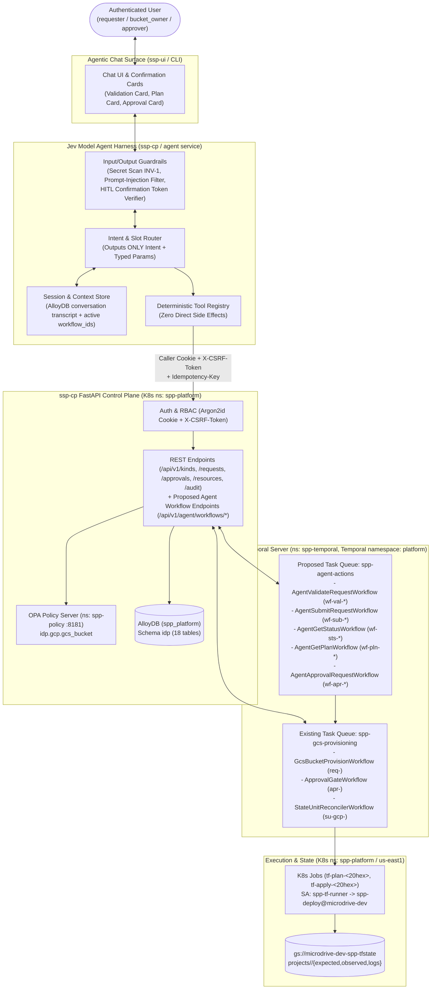
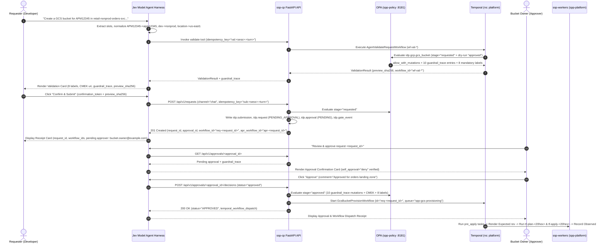

# Agentic Chatbot Experience ("Jev Model" Assistant) — `experiences/agentic-chat/`

- **Governing ADRs:**
  - [`ADR-EXP-001: Agentic Chatbot Experience for Self-Service Provisioning`](../../adr/experience/ADR-EXP-001-agentic-chatbot-experience.md) (`Status: Proposed`)
  - [`ADR-AUT-004: Agent Harness ("Jev Model") and Deterministic Temporal Workflow Execution Layer`](../../adr/automation/ADR-AUT-004-agent-harness-and-temporal-workflow-execution.md) (`Status: Proposed`)
  - [`ADR-SVC-001: First Vertical Slice — GCS Bucket (gcs_bucket) End-to-End and Guardrails`](../../adr/endpoint-service/ADR-SVC-001-first-vertical-slice-gcs-bucket.md)
  - [`ADR-GLB-003`](../../adr/global/ADR-GLB-003-four-state-model.md), [`ADR-GLB-004`](../../adr/global/ADR-GLB-004-data-model-and-database.md), [`ADR-GLB-005`](../../adr/global/ADR-GLB-005-identity-and-authentication.md), [`ADR-GLB-006`](../../adr/global/ADR-GLB-006-naming-and-labeling-conventions.md), [`ADR-GLB-007`](../../adr/global/ADR-GLB-007-governance-gates-and-policy-rego.md), [`ADR-GLB-008`](../../adr/global/ADR-GLB-008-label-and-tag-standard.md), [`ADR-BP-003`](../../adr/business-process/ADR-BP-003-roles-and-approver-governance.md), [`ADR-AUT-001`](../../adr/automation/ADR-AUT-001-terraform-execution-k8s-job.md)
- **Companion Design Doc:** [`agent-harness.md`](agent-harness.md) — Detailed specification of the **Jev model Agent Harness**, tool registry, session state, guardrails, evaluation/replay suites, and deterministic Temporal workflow contracts.
- **First Feature Covered:** Google Cloud Storage Bucket (`kind = "gcs_bucket"`, region `us-east1`, environments `nonprod` and `prod` only).
- **Submission Channel:** `channel = "chat"`, `source_ref = "jev-chat:<session_id>:<turn_id>"`.

---

## 1. Purpose & Shared Architectural Principle

The **Agentic Chatbot Experience** provides a conversational self-service interface (referred to by stakeholders as the **"Jev model"** assistant experience; tracked as an explicit Open Question in `## 10. Open Questions` to formalize exact naming and model parameters) that enables developers and resource owners to discover catalog schemas, draft and validate GCS bucket requests through natural dialogue, submit requests on the user's behalf, inspect OPA policy evaluations (`guardrail_trace`) and Terraform `plan` summaries, and track approvals through the four gates (`REQUESTED -> APPROVED -> EXPECTED -> OBSERVED`).

### Non-Negotiable Core Principles

1. **Same `ssp-cp` API & Same Policy/Approval Path (No Privileged Channel):** The chatbot has zero direct database credentials, zero direct OPA write overrides, zero direct Kubernetes Job creation permissions, and zero cloud provisioning credentials. Every action traverses the exact same `ssp-cp` FastAPI endpoints, OPA Rego packages (`idp.common`, `idp.naming`, `idp.labels`, `idp.gcp.gcs_bucket`), and `gcs_bucket_owner` v1 approval gate as the Portal UI (`ssp-ui`), MCP server (`experiences/mcp/`), and Client SDK (`experiences/sdk/`).
2. **HARD RULE — Zero Direct Side Effects from the Agent (`ADR-AUT-004`):** The LLM inside the **Jev model Agent Harness** outputs **only structured intent + typed parameters**. The agent never mutates state or calls infrastructure directly. Every action (`validate`, `submit`, `status`, `plan retrieval`, `approval requests`) is invoked via the `ssp-cp` API as a **deterministic Temporal workflow** on Temporal namespace `platform` with an explicit `idempotency_key`, returning the deterministic `workflow_id` to the conversation and using Temporal queries/signals for status and human-in-the-loop checkpoints.
3. **Human Approval Gates Are Never Bypassed:** The chatbot cannot approve a request on behalf of a human, cannot bypass `self_approval = "deny"`, and cannot trigger `AUTO_APPROVED` / `auto_approved` on any deletion (`action = "delete"`) or destructive plan (`destroy > 0` or `replace > 0`) in `nonprod` or `prod`.

---

## 2. GCS Bucket Validation & Guardrail Contract in Chat

When gathering a `gcs_bucket` request (`api_version = "idp.spp/v1"`, `kind = "gcs_bucket"`), the chatbot enforces the exact schema, normalization, naming, label, and CMEK rules implemented in `ssp-cp` (`app/naming.py`, `app/schemas.py`, `app/services.py`, and `policy/gcs_bucket.rego`):

### 2.1 Intake Normalization & Validation (`Stage 1: requested`)
- **APM ID (`NAM-APM-001`):** Accepts `^APM\d{5}$` case-insensitively during conversation (e.g., `"APM12345"`) and normalizes to lowercase `^apm\d{5}$` (`"apm12345"`) in `metadata.apm_id` and the `sppappid` label. *(Note: legacy fixture `apm0017299` in `specs/examples/gcs_bucket.gates.json` is documented for provenance, while `ssp-cp` runtime enforces `(?i)^APM\d{5}$`.)*
- **Environment (`GLB-ENV-001`):** Accepts `nonprod`, `prod`, or legacy sub-environment tokens (`sandbox`, `dev`, `qa`, `test`, `pdev`, `pqa`, `preprod`) and normalizes all non-prod values to **`nonprod` (no hyphen)** or **`prod`**.
- **LOB & Data Sensitivity:** Lowercases `metadata.lob` (`^([a-z][a-z0-9]{1,5}|<lob>)$`); normalizes `"restrict"` -> `"restricted"` and `"unrestrict"` -> `"unrestricted"`.
- **Region (`GLB-REG-001`):** Enforces `spec.location == "us-east1"` in both `nonprod` and `prod`. Multi-region `"US"` or other regions are rejected immediately.
- **Bucket Naming (`GCS-NAME-001..003`, `NAM-RSV-001`, `NAM-IMM-001`, `NAM-LEG-001`):**
  - Template: `{lob}-{env}-{app}-{purpose}-{suffix}` (`<= 63` chars, lowercase).
  - `{app}` resolved from `idp.apm_alias` (or `metadata.labels.app` fallback, e.g., `orders`).
  - `{purpose}`: `2..20` char kebab-case; rejects reserved words (`non-prod`, `nonprod`, `prod`, `sandbox`, `dev`, `qa`, `test`, `pdev`, `pqa`, `preprod`, `restricted`, `unrestricted` per `NAM-RSV-001`).
  - Rejects prefix `goog` and substrings `google`, `g00gle` (`GCS-NAME-002`).
  - `{suffix}`: 4-char lowercase alphanumeric drawn by `ssp-cp` up to `max_attempts = 5` (`GCS-NAME-003`).
- **IAM Access Allowlist (`GCS-IAM-001`, `GCS-IAM-002`):**
  - Principals: Only `group:` and `serviceAccount:` members are allowed (rejects `user:`, `allUsers`, `allAuthenticatedUsers`).
  - Roles: Only `roles/storage.objectAdmin`, `roles/storage.objectViewer`, and `roles/storage.objectCreator` are allowed.
- **Lifecycle Rules (`GCS-LFC-001`, `GCS-LFC-002`):** Default to **`[]` (NONE)** (`ADR-SVC-001 REQ-3`). Optional user-supplied `Delete` or `SetStorageClass` rules are validated (`Delete` `age_days >= retention_days` `90`).
- **Versioning vs. Retention (`GCS-RET-001`):** Rejects `versioning: true` when the 90-day retention policy applies.
- **Guardrail-Owned & Secret Fields Rejected (`GCS-GRD-001`, `INV-001`):** Callers cannot set `uniform_bucket_level_access`, `public_access_prevention`, `kms_key_name`, `default_kms_key_name`, `retention_days`, `retention_locked`, `soft_delete_retention_days`, or `force_destroy` in `requested`, and any payload containing secret key names (`password`, `passwd`, `client_secret`, `private_key`, `secret_value`, `api_key`, `token`) is rejected.

### 2.2 Mandatory Labels (`LBL-001` & `LBL-002`)
The chatbot previews and verifies all **8 mandatory labels** (plus 3 metadata-derived labels), confirming that `environmentsubtype` is **dropped and forbidden everywhere**:

| # | Label Key | Category | Source / Value Rule | Example Value |
| :--- | :--- | :--- | :--- | :--- |
| **1** | `sppappid` | **Mandatory (1/8)** | `metadata.apm_id` (lowercased `^apm\d{5}$`) | `apm12345` |
| **2** | `costcenter` | **Mandatory (2/8)** | `metadata.cost_center` | `000000` |
| **3** | `environmenttype` | **Mandatory (3/8)** | `nonprod` or `prod` only (`environmentsubtype` forbidden) | `nonprod` |
| **4** | `primarylob` | **Mandatory (4/8)** | `metadata.lob` (lowercased) | `retail` |
| **5** | `datasensitivity` | **Mandatory (5/8)** | `metadata.data_sensitivity` (`restricted` \| `unrestricted` \| `internal` \| `public`) | `restricted` |
| **6** | `owner` | **Mandatory (6/8)** | `metadata.owner` normalized via `LBL-002` (`[^a-z0-9_-]` -> `_`, max 63 chars) | `bucket_owner_example_com` |
| **7** | `provisionedby` | **Mandatory (7/8)** | Constant `"idp"` | `idp` |
| **8** | `idp_resource_id` | **Mandatory (8/8)** | Deterministic UUID of `idp.resource.resource_id` | `9478bcfc-c2cf-583b-8bd8-096476647840` |
| — | `dataclassification` | Metadata-derived | `metadata.data_classification` | `proprietary` |
| — | `sharedemailaddress` | Metadata-derived | `metadata.shared_mailbox` normalized via `LBL-002` | `retail-orders-team_example_com` |
| — | `tenancy` | Metadata-derived | `metadata.tenancy` (`dedicated` \| `shared`) | `dedicated` |

### 2.3 Enforced Guardrails & CMEK Key (`Stage 2: approved`)
When displaying the policy preview and `guardrail_trace`, the chatbot shows all 10 injected guardrails from `idp.gcp.gcs_bucket`:
- **`GCS-UBLA-001`:** `/spec/uniform_bucket_level_access` -> `true`
- **`GCS-PAP-001`:** `/spec/public_access_prevention` -> `"enforced"`
- **`GCS-ENC-001`:** `/spec/kms_key_name` -> **`"projects/microdrive-dev/locations/us-east1/keyRings/spp-keyring/cryptoKeys/spp-gcs-cmek"`**
- **`GCS-RET-001`:** `/spec/retention_days` -> `90` (`7776000` seconds in `Expected` `tfvars`)
- **`GCS-RET-003`:** `/spec/retention_locked` -> `false`
- **`GCS-SDP-001`:** `/spec/soft_delete_retention_days` -> `7` (`604800` seconds in `Expected` `tfvars`)
- **`GCS-DEL-001`:** `/spec/force_destroy` -> `false`
- **`LBL-001`:** `/metadata/labels` -> merged 8 mandatory + metadata-derived + user labels
- **`PRQ-001`:** `/prerequisites/0` -> `ad_group` (`pre_apply` `idp.lifecycle_task`)
- **`PRQ-002`:** `/prerequisites/1` -> `vpc_sc_ingress` into `<lob>_<env>_restricted_perimeter` when `data_sensitivity == "restricted"`

---

## 3. User Journeys

### Journey 1: Conversational Slot-Filling & Validation for GCS Bucket Creation
1. **Opening Intent:** Developer (`requester@example.com`) types: *"I need a GCS bucket for APM12345 in project retail-nonprod-orders-svc (LOB retail, dev environment) to land order events. Owner is bucket.owner@example.com."*
2. **Slot Extraction & Normalization (No Side Effects):**
   - The Jev model harness extracts `intent = "provision_gcs_bucket"`, normalizes `APM12345 -> apm12345`, `dev -> nonprod`, `location -> us-east1`, `purpose_token -> landing`, `lifecycle_rules -> []`, and identifies any missing required fields (e.g., `access` IAM bindings or `cost_center`).
   - Asking at most 3 clarifying questions per turn, the assistant asks whether any `group:` or `serviceAccount:` principals need `roles/storage.objectViewer` or `roles/storage.objectAdmin`.
3. **Deterministic Validation Workflow (`validate`):**
   - Once parameters are complete, the harness invokes `POST /api/v1/agent/workflows/validate` *(proposed endpoint wrapping OPA `requested` + `approved` dry-run)* or validates against `ssp-cp`'s schema/OPA rules, starting deterministic Temporal workflow `wf-val-<sha256(session_id:turn_id)[:16]>` on namespace `platform`.
   - The assistant renders a **Validation & Policy Preview Card** displaying:
     - Candidate bucket name format: `retail-nonprod-orders-landing-<4char>` in `us-east1`
     - All **8 mandatory labels** (with `sppappid: "apm12345"`, `environmenttype: "nonprod"`, `owner: "bucket_owner_example_com"`, `provisionedby: "idp"`)
     - The 10 `guardrail_trace` injections, including CMEK key `projects/microdrive-dev/locations/us-east1/keyRings/spp-keyring/cryptoKeys/spp-gcs-cmek`
     - Required human approval gate: `gcs_bucket_owner` v1 (`approver_identity = "bucket.owner@example.com"`, `self_approval = "deny"`)
     - Deterministic `workflow_id` and `preview_sha256` hash.

### Journey 2: Human Confirmation Checkpoint & Request Submission (`submit`)
1. **Explicit User Confirmation (HITL Checkpoint 1):** The assistant never submits on inferred intent. The user must click **Confirm & Submit Request** or type `confirm <preview_sha256[:8]>`.
2. **Deterministic Submission Workflow:**
   - The harness calls `POST /api/v1/requests` (with `channel = "chat"`, `idempotency_key = "chat:<session_id>:<turn_id>"`, and the user's session cookie + `X-CSRF-Token`).
   - `ssp-cp` persists `idp.submission`, `idp.request` (`status = "PENDING_APPROVAL"`, `temporal_workflow_id = "req-<request_id>"`), `idp.policy_evaluation` (`stage = "requested"`), `idp.approval` (`status = "PENDING"`, `temporal_workflow_id = "apr-<request_id>"`), `idp.approval_decision` (`phase = 0`, `approver_key = "bucket_owner"`, `status = "pending"`), and `idp.gate_event`.
   - The assistant displays the `request_id`, `resource_id`, `approval_id`, `req-<request_id>`, and `apr-<request_id>`.

### Journey 3: Human Approval Gate (`approval requests` — Non-Bypassable)
1. **Self-Approval Denial:** If `requester@example.com` asks the chatbot *"Approve my bucket request"*, the harness checks the caller's identity and `ssp-cp` enforces `self_approval = "deny"` (`403 Forbidden`), explaining that `bucket.owner@example.com` (or an authorized `approver` / `architect` / `operations` role who is not the requester) must approve.
2. **Owner Approval with HITL Checkpoint 2:** When `bucket.owner@example.com` logs in and asks *"Show my pending approvals and approve request `<request_id>`"*, the harness invokes the read workflow/endpoint `GET /api/v1/approvals?status=PENDING`, displays the request diff and `guardrail_trace`, requires explicit human confirmation, and calls `POST /api/v1/approvals/{approval_id}/decisions` (`status = "approved"`, `comment = "..."`).
3. **Transition to Gate 2 (`APPROVED`) & Temporal Provisioning Start:**
   - `ssp-cp` evaluates OPA `stage = "approved"`, writes the 10-entry `guardrail_trace` and `approved_spec` (`approved_spec_sha256`), materializes `pre_apply` (`PRQ-001` `ad_group`, `PRQ-002` `vpc_sc_ingress`) and `post_apply` (`notify_owner`) `idp.lifecycle_task` rows, and dispatches **`GcsBucketProvisionWorkflow`** (`workflow_id = "req-<request_id>"`) on Temporal namespace `platform`, task queue `spp-gcs-provisioning`.

### Journey 4: Status & Terraform Plan Inspection (`status` & `plan retrieval`)
1. **Querying Progress:** The user asks *"What is the status and Terraform plan for `<request_id>`?"*
2. **Deterministic Status & Plan Retrieval:**
   - The harness calls `GET /api/v1/requests/{request_id}` and `GET /api/v1/resources/{resource_id}` (and queries the Temporal workflow `req-<request_id>` / `su-gcp-<project_id>` via `ssp-cp`).
   - The assistant renders the 4-gate progress bar (`REQUESTED -> APPROVED -> EXPECTED -> OBSERVED`), the `Expected` revision (`rev-000001`), the deterministic Kubernetes Job names (`tf-plan-eba5f9ebf4fafecad8e9` and `tf-apply-b85d57b4511c03e98373` in namespace `spp-platform`), the `plan_summary` (`{"add": 3, "change": 0, "destroy": 0, "replace": 0}`), the `< 2000`-byte `Observed` projection (`cloud_resource_id = "projects/_/buckets/..."`), and any open drift findings (`open_drift_count`).

### Journey 5: Day-2 Update or Delete Request (`delete` Guardrail)
1. If a user asks to delete a bucket (`action = "delete"`), the chatbot warns that bucket deletion is destructive, verifies `force_destroy == false` (`GCS-DEL-001`), submits a `delete` request with `base_approval_id`, and enforces that **`AUTO_APPROVED` / `auto_approved` is strictly forbidden in both `nonprod` and `prod`**.

---

## 4. Architecture & Sequence Diagrams

### 4.1 Component Architecture

### 4.2 End-to-End Conversational Provisioning Sequence

---

## 5. API Contract Mapping to `ssp-cp` (Real vs. Proposed Endpoints)

Per repository rules, **we do not invent undocumented endpoints as if they already exist**. The table below distinguishes **existing (`REAL`)** endpoints verified in `vaishnavi4068/ssp-cp` (`app/main.py`) from **proposed (`PROPOSED`)** endpoints for the Jev model Agent Harness (`ADR-EXP-001`, `ADR-AUT-004`):

| Operation | HTTP Method & Path | Status in `ssp-cp` | Temporal Workflow / Action on `platform` | Purpose in Agentic Chat Experience |
| :--- | :--- | :--- | :--- | :--- |
| **Verify Caller Identity & CSRF** | `GET /api/v1/me` | **REAL** (`app/main.py:412`) | None (session lookup) | Resolves authenticated user (`username`, `email`, `role`, `must_change_password`, `csrf_token`). Blocks chat actions if `must_change_password == true`. |
| **List Enabled Resource Kinds** | `GET /api/v1/kinds` | **REAL** (`app/main.py:434`) | Read query / `AgentListCatalogWorkflow` | Discovers `gcs_bucket` metadata (`schema_uri`, `schema_version`, `tf_module_source`, `tfvars_collection = "gcs_buckets"`, `opa_package = "idp.gcp.gcs_bucket"`, `approval_gate_key = "gcs_bucket_owner"`). |
| **Dry-Run Validate & Preview Guardrails** | `POST /api/v1/agent/workflows/validate` *(or `POST /api/v1/requests/validate`)* | **PROPOSED** (`ADR-EXP-001`, `ADR-AUT-004`) | **`AgentValidateRequestWorkflow`** (`wf-val-<hash>`, task queue `spp-agent-actions`) | Runs `ssp-cp` intake normalization + OPA `stage = 'requested'` and `stage = 'approved'` in dry-run mode without writing `idp.request`, returning normalized `requested_spec`, `guardrail_trace`, 8 mandatory labels, `preview_sha256`, and `workflow_id`. |
| **Submit GCS Bucket Request** | `POST /api/v1/requests` *(alias `POST /api/v1/submissions`)* | **REAL** (`app/main.py:466`) | **`AgentSubmitRequestWorkflow`** (`wf-sub-<hash>`) -> creates `req-<request_id>` & `apr-<request_id>` | Submits canonical `CreateRequestPayload` (`channel = "chat"`, `idempotency_key`), evaluates OPA `stage = 'requested'`, persists Gate 1 & Gate 2 `PENDING` rows in AlloyDB. |
| **Get Request Status, Policy Trace & Tasks** | `GET /api/v1/requests/{request_id}` & `GET /api/v1/requests` | **REAL** (`app/main.py:499, 514`) | **`AgentGetStatusWorkflow`** / Temporal Query on `req-<request_id>` | Returns `requested`, `submission`, `resource` (`gate`, `lifecycle`, `sync_status`), `approval` (`guardrail_trace`, `decisions`, `lifecycle_tasks`), and `policy_evaluations`. |
| **Get Resource Status, Observed Projection & Drift** | `GET /api/v1/resources/{resource_id}` & `GET /api/v1/resources` *(alias `/api/v1/status`)* | **REAL** (`app/main.py:649, 658`) | Temporal Query on `su-gcp-<project_id>` + `idp.v_resource_status` | Returns 4-gate summary (`expected_revision_no`, `expected_revision_status`), `< 2000`-byte `observed.projection` (`cloud_resource_id`), and `drift_findings`. |
| **Retrieve Revision Plan & Runner Job Logs** | `GET /api/v1/requests/{request_id}/plan` | **PROPOSED** (`ADR-EXP-001`, `ADR-AUT-004`) | **`AgentGetPlanWorkflow`** (`wf-pln-<hash>`, task queue `spp-agent-actions`) | Returns `idp.expected_revision.plan_summary` (`{add, change, destroy, replace}`), `idp.tf_operation` (`k8s_job_name = "tf-plan-<20hex>"`, `tf_exit_code`, `logs_uri`), and redacted plan diff summary without exposing raw `.tfstate`. |
| **List & Inspect Pending Approvals** | `GET /api/v1/approvals` & `GET /api/v1/approvals/{approval_id}` | **REAL** (`app/main.py:529, 544`) | **`AgentApprovalRequestWorkflow`** (query mode) | Lists pending `gcs_bucket_owner` approvals and decision SLA deadlines (`sla_deadline`). |
| **Record Human Approval Decision** | `POST /api/v1/approvals/{approval_id}/decisions` *(aliases `/api/v1/requests/{id}/approve`, `/decisions`)* | **REAL** (`app/main.py:557`) | Signals `apr-<request_id>` & starts **`GcsBucketProvisionWorkflow`** (`req-<request_id>`, task queue `spp-gcs-provisioning`) | Records human `approved` / `denied` / `escalated` decision (enforcing `self_approval = "deny"` and no `auto_approved` deletes), runs OPA `stage = 'approved'`, writes `guardrail_trace`, and dispatches `GcsBucketProvisionWorkflow` on Temporal namespace `platform`. |
| **Inspect Audit & Gate Events** | `GET /api/v1/audit` | **REAL** (`app/main.py:784`) | Read query | Returns `gate_events`, `audit_logs`, and `policy_evaluations` filtered by `request_id` or `resource_id`. |
| **Chat Conversation Turn API** | `POST /api/v1/agent/conversations` & `POST /api/v1/agent/conversations/{session_id}/messages` | **PROPOSED** (`ADR-EXP-001`, `ADR-AUT-004`) | Invokes `spp-agent-actions` workflows | Hosts the server-side Jev model Agent Harness turn loop, returning structured cards, `workflow_id`s, and HITL confirmation tokens. |

---

## 6. Security & Identity (`ADR-GLB-005`)

1. **Zero Independent Agent Privilege:** The Jev model chatbot executes every `ssp-cp` call using the **authenticated human user's session** (`__Host-spp_cp_session` cookie + `X-CSRF-Token` header for state-changing requests, or OIDC/SSO Bearer JWT when corporate SSO is enabled). It never uses a service-wide admin token to submit or approve requests.
2. **On-Behalf-Of Attribution:** Every submission from chat sets `channel = "chat"`, `submitted_by = <user.email>`, `on_behalf_of = <user.email>`, and `source_ref = "jev-chat:<session_id>:<turn_id>"`.
3. **Mandatory First-Login Password Rotation Enforcement:** If `GET /api/v1/me` returns `must_change_password = true`, the chatbot refuses all provisioning/approval commands and directs the user to rotate their bootstrap password (`POST /api/v1/auth/change-password`).
4. **Prompt-Injection & Untrusted Data Posture:** Resource names, drift values, logs, and user free-text are treated strictly as untrusted data (`AGENTS.md` Rule 8). Free text never reaches Terraform or shell execution; the LLM can only populate typed Pydantic / JSON Schema slots validated by `ssp-cp` and OPA.
5. **Zero Secrets (`INV-1`):** The harness scans every user message and drafted payload using `scan_for_secrets()` (`password`, `passwd`, `client_secret`, `private_key`, `secret_value`, `api_key`, `token`) before calling `ssp-cp` and blocks any attempt to pass credentials or GCP service account JSON keys.

---

## 7. Approval & No-Delete Rules (`ADR-BP-003`, `ADR-GLB-007`, `ADR-AUT-002`)

- **Mandatory Human Approval Gate (`gcs_bucket_owner` v1):** Every `gcs_bucket` request creates a pending `idp.approval_decision` row for `bucket_owner` (`/metadata/owner`, 5-day SLA, manager escalation after 4 follow-ups, 13-day auto-close, 30-day `valid_until`).
- **Strict Self-Approval Denial (`self_approval = "deny"`):** Even if the logged-in chat user is listed as `metadata.owner`, they cannot approve a request they submitted (`requested_by == responded_by` is blocked with `403 Forbidden`).
- **Universal Human Approval for All Deletes & Destructive Plans:**
  - `action = "delete"` requests and any Terraform plan with `plan_summary.destroy > 0` or `plan_summary.replace > 0` require explicit human approval in **both `nonprod` and `prod`**.
  - `AUTO_APPROVED` (on `idp.approval`) and `auto_approved` (on `idp.approval_decision`) are strictly forbidden for deletes across all environments.
  - `force_destroy` is permanently enforced to `false` (`GCS-DEL-001`), and `retention_locked` is permanently enforced to `false` (`GCS-RET-003`).
- **Two-Stage Human Confirmation in Chat:**
  1. **Submission Checkpoint:** User must explicitly confirm the `preview_sha256` card before `POST /api/v1/requests` is called.
  2. **Approver Checkpoint:** A distinct human approver (`bucket_owner` / `approver` role) must explicitly confirm the approval card before `POST /api/v1/approvals/{approval_id}/decisions` is called.

---

## 8. Observability & Audit (`ADR-GLB-004`, `ADR-AUT-004`)

- **Immutable Database Audit Trail:** Every chat-initiated action writes to:
  - `idp.submission` (`channel = 'chat'`, `raw_payload_sha256`, `idempotency_key`)
  - `idp.policy_evaluation` (`stage IN ('requested', 'approved', 'plan')`, `bundle_revision = '3f9a1c2'`, `input_sha256`, `violations`, `mutations`)
  - `idp.gate_event` (`request.submitted`, `approval.granted`, `approval.denied`, with `actor = "user:<email>"`)
  - `idp.cp_audit_log` (`actor_username`, `actor_role`, `source_ip`, `action_type`, `resource_id`, `request_id`, `approval_id`, `reason`, `details`)
- **Temporal Workflow Traceability:** Every assistant turn that invokes a tool returns the Temporal `workflow_id` (`wf-val-*`, `req-<request_id>`, `apr-<request_id>`, `su-gcp-<project_id>`), `namespace = "platform"`, and `task_queue` (`spp-agent-actions` or `spp-gcs-provisioning`) in the chat transcript metadata.
- **OpenTelemetry & Redaction:** Every turn emits an OpenTelemetry trace span (`jev.chat.turn`) correlated with `X-Request-Id`, `session_id`, `turn_id`, `request_id`, and `workflow_id`, with PII/secret scrubbing on all logs.

---

## 9. MVP Scope vs. Later Phases

| Capability | MVP Scope (GCS Bucket Vertical Slice — Current) | Later Phases (Phase 5 UI Integration & Phase 6+ Multi-Kind) |
| :--- | :--- | :--- |
| **Supported Resource Kinds** | `gcs_bucket` in `us-east1` (`nonprod` and `prod`) | `spanner_instance`, `spanner_database` (`ADR-SVC-002`), GCE VM, Cloud SQL/AlloyDB, BigQuery dataset |
| **Actions Supported** | `create`, `status`, `plan` inspection, `approvals` list/decision, Day-2 `update` (labels, storage class, optional `lifecycle_rules`) and `delete` (human-approved) | Brownfield `import` (`NAM-LEG-001`), multi-resource bundles, automated drift remediation request drafting |
| **Execution Layer** | Deterministic Temporal workflows on namespace `platform` (`spp-gcs-provisioning` + proposed `spp-agent-actions`) via `ssp-cp` | Streaming SSE progress from Temporal workflow activities directly into the `ssp-ui` slide-over drawer |
| **Authentication** | Local Argon2id login (`POST /api/v1/auth/login`), `__Host-spp_cp_session` cookie + `X-CSRF-Token` | Corporate OIDC / SAML SSO with delegated OAuth scopes |
| **Knowledge / RAG Grounding** | Grounded over `ssp-doc` ADRs (`ADR-GLB-*`, `ADR-BP-*`, `ADR-SVC-001`, `ADR-AUT-*`) and `specs/` | Live tenant inventory and historical LOB order pattern recommendations |

---

## 10. Open Questions

- [ ] **OQ-EXP-CHAT-1 ("Jev Model" Definition & Backing LLM Endpoint — [Owner: Manoj / Dwayne]):** Confirm the exact definition, origin, and backing Vertex AI model endpoint/parameters for the **"Jev model"** conversational assistant experience (e.g., whether "Jev model" denotes a fine-tuned Gemini 2.5 Pro configuration on Vertex AI in `microdrive-dev` or an internal conversational persona/architecture codename).
- [ ] **OQ-EXP-CHAT-2 (Dedicated Agent Task Queue `spp-agent-actions` vs. Reusing `spp-gcs-provisioning` — [Owner: Dwayne / Manoj]):** Confirm whether synchronous/short-lived agent tool workflows (`AgentValidateRequestWorkflow`, `AgentGetPlanWorkflow`) should run on a dedicated Temporal task queue `spp-agent-actions` in namespace `platform` (recommended to isolate interactive chat latency from long-running Terraform K8s Job polling on `spp-gcs-provisioning`).
- [ ] **OQ-EXP-CHAT-3 (Conversation Transcript Retention in AlloyDB — [Owner: Manoj / Raju]):** Confirm the AlloyDB table schema (`idp.agent_conversation`, `idp.agent_message`) and retention window (proposed: 90 days) for storing Jev model chat transcripts and workflow receipts.
