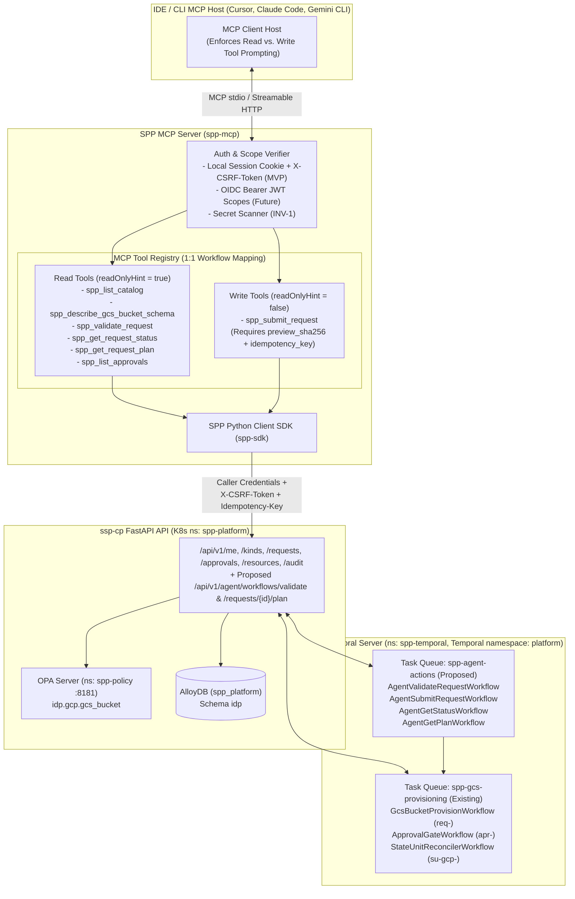

# MCP Server Experience (`spp-mcp`) — `experiences/mcp/`

- **Governing ADRs:**
  - [`ADR-EXP-002: MCP Server Experience for Self-Service Provisioning`](../../adr/experience/ADR-EXP-002-mcp-server-experience.md) (`Status: Proposed`)
  - [`ADR-AUT-004: Agent Harness ("Jev Model") and Deterministic Temporal Workflow Execution Layer`](../../adr/automation/ADR-AUT-004-agent-harness-and-temporal-workflow-execution.md) (`Status: Proposed`)
  - [`ADR-SVC-001: First Vertical Slice — GCS Bucket (gcs_bucket) End-to-End and Guardrails`](../../adr/endpoint-service/ADR-SVC-001-first-vertical-slice-gcs-bucket.md)
  - [`ADR-GLB-003`](../../adr/global/ADR-GLB-003-four-state-model.md), [`ADR-GLB-004`](../../adr/global/ADR-GLB-004-data-model-and-database.md), [`ADR-GLB-005`](../../adr/global/ADR-GLB-005-identity-and-authentication.md), [`ADR-GLB-006`](../../adr/global/ADR-GLB-006-naming-and-labeling-conventions.md), [`ADR-GLB-007`](../../adr/global/ADR-GLB-007-governance-gates-and-policy-rego.md), [`ADR-GLB-008`](../../adr/global/ADR-GLB-008-label-and-tag-standard.md), [`ADR-GLB-009`](../../adr/global/ADR-GLB-009-resource-kind-registry.md), [`ADR-BP-003`](../../adr/business-process/ADR-BP-003-roles-and-approver-governance.md), [`ADR-AUT-001`](../../adr/automation/ADR-AUT-001-terraform-execution-k8s-job.md)
- **First Feature Covered:** Google Cloud Storage Bucket (`kind = "gcs_bucket"`, region `us-east1`, environments `nonprod` and `prod` only).
- **Submission Channel:** `channel = "api"` (or `"chat"` when invoked from an IDE chat client), `source_ref = "mcp:<tool_name>:<client_id>"`.

---

## 1. Purpose & Shared Architectural Principle

The **MCP Server Experience (`spp-mcp`)** exposes the Self-Service Provisioning Platform (SPP) through the **Model Context Protocol (MCP)** so IDE and CLI AI coding assistants (Cursor, Claude Code, Gemini CLI) can inspect the SPP service catalog, describe the GCS bucket schema and guardrail rules, dry-run validate requests, submit GCS bucket requests on the user's behalf, inspect 4-gate status and Terraform plans, and list pending approvals.

### Non-Negotiable Core Principles

1. **Same `ssp-cp` API & Same Policy/Approval Path (No Privileged Channel):** `spp-mcp` is a stateless protocol adapter backed exclusively by the `ssp-cp` FastAPI API (via the `spp-sdk` Python client). It has zero direct connectivity to AlloyDB (`spp_platform`), zero direct OPA override access, zero Kubernetes Job launch permissions, and zero GCS state bucket credentials.
2. **1:1 Mapping to Deterministic Temporal Workflows (`ADR-AUT-004`):** In alignment with the **Jev model Agent Harness** ([`../agentic-chat/agent-harness.md`](../agentic-chat/agent-harness.md)), MCP tools never execute side effects directly. Every MCP tool maps **1:1** to the same deterministic Temporal workflows on Temporal namespace **`platform`** (using proposed task queue `spp-agent-actions` for interactive validation/status/plan workflows and existing task queue `spp-gcs-provisioning` for `GcsBucketProvisionWorkflow` / `ApprovalGateWorkflow` / `StateUnitReconcilerWorkflow`), passing an explicit `idempotency_key` and returning deterministic `workflow_id`s in every tool response.
3. **Strict Read vs. Write Tool Separation & Human-Only Approvals:**
   - **Read tools** (`spp:catalog:read`, `spp:requests:read`, `spp:approvals:read`) are side-effect-free (`readOnlyHint = true`) and safe for autonomous inspection.
   - **Write tools** (`spp:requests:write`) require a valid `preview_sha256` from `spp_validate_request`, an `idempotency_key`, and a human confirmation step (`destructiveHint = false` for `create`/`update`, `destructiveHint = true` for `delete`).
   - **Approvals Stay Strictly Human (`ADR-BP-003`):** By default, `spp-mcp` exposes **read-only approval inspection (`spp_list_approvals`)** so AI agents cannot autonomously approve infrastructure requests. Any approval decision must be executed by a human approver (`bucket_owner` / `approver` role, `self_approval = "deny"`), and `AUTO_APPROVED` / `auto_approved` is permanently forbidden on all deletes in `nonprod` and `prod`.

---

## 2. MCP Tool Catalog & 1:1 Temporal Workflow Mapping (GCS Bucket First)

| Tool Name | Category | Required Scope | MCP Annotations | `ssp-cp` Endpoint (`REAL` vs. `PROPOSED`) | 1:1 Temporal Workflow on `platform` (`ADR-AUT-004`) | Purpose & Returned Contract |
| :--- | :--- | :--- | :--- | :--- | :--- | :--- |
| **`spp_list_catalog`** | **Read** | `spp:catalog:read` | `readOnlyHint: true`<br>`idempotentHint: true` | **REAL:** `GET /api/v1/kinds` (`app/main.py:434`) | `AgentListCatalogWorkflow` (`wf-cat-*` on `spp-agent-actions`) | Lists enabled resource kinds in `idp.resource_kind` (`gcs_bucket`, `spanner_instance`, `spanner_database`), returning `tfvars_collection`, `tf_address_template`, `opa_package`, `approval_gate_key`, and `drift_ignore_paths`. |
| **`spp_describe_gcs_bucket_schema`** | **Read** | `spp:catalog:read` | `readOnlyHint: true`<br>`idempotentHint: true` | **REAL:** `GET /api/v1/kinds` + **PROPOSED:** `GET /api/v1/kinds/gcs_bucket/schema` | `AgentDescribeSchemaWorkflow` (`wf-sch-gcs_bucket-1.0.0` on `spp-agent-actions`) | Returns the complete `gcs_bucket` intake schema (`RequestMetadataInput`, `GcsBucketSpecInput`), naming template `{lob}-{env}-{app}-{purpose}-{suffix}`, APM ID regex `(?i)^APM\d{5}$` -> `^apm\d{5}$`, the **8 mandatory labels** (`LBL-001`), the CMEK key URI (`projects/microdrive-dev/locations/us-east1/keyRings/spp-keyring/cryptoKeys/spp-gcs-cmek`), and forbidden guardrail-owned fields (`GCS-GRD-001`). |
| **`spp_validate_request`** | **Read / Dry-Run** | `spp:requests:read` | `readOnlyHint: true`<br>`idempotentHint: true` | **PROPOSED:** `POST /api/v1/agent/workflows/validate` *(or `POST /api/v1/requests/validate`)* | **`AgentValidateRequestWorkflow`** (`wf-val-<20hex>` on `spp-agent-actions`) | Runs `ssp-cp` intake normalization + OPA `idp.gcp.gcs_bucket` at `stage = "requested"` and dry-run `stage = "approved"`. Returns `decision` (`allow` \| `deny` \| `allow_with_mutations`), `violations`, normalized `requested_spec`, computed **8 mandatory labels**, 10-entry `guardrail_trace`, `preview_sha256`, and `workflow_id`. |
| **`spp_submit_request`** | **Write** | `spp:requests:write` | `readOnlyHint: false`<br>`idempotentHint: true`<br>`destructiveHint: true` *(if `action == "delete"`)* | **REAL:** `POST /api/v1/requests` (`app/main.py:466`) | **`AgentSubmitRequestWorkflow`** (`wf-sub-<20hex>`) -> creates `req-<request_id>` & `apr-<request_id>` | Requires `idempotency_key` and `preview_sha256` from `spp_validate_request`. Submits the normalized request to `ssp-cp` on the user's behalf, persisting Gate 1 (`Requested`) and Gate 2 (`PENDING` `Approval`) in AlloyDB and returning `request_id`, `resource_id`, `approval_id`, `req-<request_id>`, and `apr-<request_id>`. |
| **`spp_get_request_status`** | **Read** | `spp:requests:read` | `readOnlyHint: true`<br>`idempotentHint: true` | **REAL:** `GET /api/v1/requests/{request_id}` & `GET /api/v1/resources/{resource_id}` (`app/main.py:514, 658`) | **`AgentGetStatusWorkflow`** / Temporal Query on `req-<request_id>` & `su-gcp-<project_id>` | Returns 4-gate status (`REQUESTED -> APPROVED -> EXPECTED -> OBSERVED`), `approval.status`, `guardrail_trace`, `decisions`, `lifecycle_tasks`, `< 2000`-byte `observed.projection`, `open_drift_count`, and `drift_findings`. |
| **`spp_get_request_plan`** | **Read** | `spp:requests:read` | `readOnlyHint: true`<br>`idempotentHint: true` | **REAL:** `GET /api/v1/requests/{request_id}` + **PROPOSED:** `GET /api/v1/requests/{request_id}/plan` | **`AgentGetPlanWorkflow`** (`wf-pln-<request_id>-<rev>` on `spp-agent-actions`) | Returns the `Expected` revision (`revision_no`, `artifact_uri`, `artifact_sha256`), `plan_summary` (`{add, change, destroy, replace}`), deterministic runner Job details (`k8s_job_name = "tf-plan-<20hex>"`, `tf_exit_code`, `logs_uri`), and OPA `stage = "plan"` evaluation result without exposing raw `.tfstate` secrets. |
| **`spp_list_approvals`** | **Read** | `spp:approvals:read` | `readOnlyHint: true`<br>`idempotentHint: true` | **REAL:** `GET /api/v1/approvals` & `GET /api/v1/approvals/{approval_id}` (`app/main.py:529, 544`) | **`AgentListApprovalsWorkflow`** / Temporal Query on `apr-<request_id>` | Lists pending/decided approvals (`gate_key = "gcs_bucket_owner"`, `gate_version = 1`), sequential `decisions` (`approver_key = "bucket_owner"`, `approver_identity`, `sla_deadline`), `guardrail_trace`, and instructions for the human approver to sign off via Portal/CLI/Chat. |

*(Note: `POST /api/v1/approvals/{approval_id}/decisions` is intentionally NOT exposed as an autonomous MCP tool in the default developer profile so AI coding agents cannot approve requests. Human approvers execute decisions via `ssp-ui`, the HITL-gated approver view, or explicit human CLI confirmation.)*

---

## 3. User Journeys

### Journey 1: IDE Developer Provisions a Compliant GCS Bucket via Cursor / Claude Code
1. **Discovery & Schema Inspection:** A developer in Cursor asks: *"Create a GCS landing bucket for APM12345 in project retail-nonprod-orders-svc (LOB retail, dev) with read access for group:gcp-retail-nonprod-orders-read@example.com."*
2. **Read Tool Calls (`spp_list_catalog` -> `spp_describe_gcs_bucket_schema`):**
   - The MCP client calls `spp_describe_gcs_bucket_schema` and learns the required metadata/spec structure, the 8 mandatory labels (`sppappid`, `costcenter`, `environmenttype`, `primarylob`, `datasensitivity`, `owner`, `provisionedby`, `idp_resource_id`), `location = "us-east1"`, and CMEK URI `projects/microdrive-dev/locations/us-east1/keyRings/spp-keyring/cryptoKeys/spp-gcs-cmek`.
3. **Dry-Run Validation (`spp_validate_request`):**
   - The MCP client calls `spp_validate_request` with the drafted payload and `idempotency_key`.
   - `ssp-cp` executes `AgentValidateRequestWorkflow` (`wf-val-*`), normalizing `APM12345 -> apm12345` and `dev -> nonprod`, checking `idp.gcp.gcs_bucket` Rego rules, and returning `decision = "allow_with_mutations"`, the 10-entry `guardrail_trace`, and `preview_sha256`.
4. **Human Confirmation & Submission (`spp_submit_request`):**
   - The IDE assistant presents the `guardrail_trace`, 8 mandatory labels, and `preview_sha256` to the developer.
   - Upon the developer's explicit approval of the MCP write tool call, `spp_submit_request` invokes `POST /api/v1/requests` (`channel = "api"`, `source_ref = "mcp:spp_submit_request"`), returning `request_id`, `approval_id`, `req-<request_id>`, and `apr-<request_id>`.

### Journey 2: Checking Approval Queue, Policy Trace, and Terraform Plan
1. The developer asks: *"Is my bucket request `<request_id>` approved yet, and what does the Terraform plan look like?"*
2. The MCP client calls `spp_get_request_status` (`GET /api/v1/requests/{request_id}`) and `spp_get_request_plan`.
3. Before approval, the tool reports `gate = "REQUESTED"`, `status = "PENDING_APPROVAL"`, waiting on `bucket_owner` (`bucket.owner@example.com`, SLA deadline 5 days).
4. Once `bucket.owner@example.com` approves via `POST /api/v1/approvals/{approval_id}/decisions` (which triggers `GcsBucketProvisionWorkflow` on `spp-gcs-provisioning`), `spp_get_request_plan` returns `plan_summary = {"add": 3, "change": 0, "destroy": 0, "replace": 0}` from Job `tf-plan-eba5f9ebf4fafecad8e9` in namespace `spp-platform`, and `spp_get_request_status` returns `gate = "OBSERVED"`, `sync_status = "IN_SYNC"`, and the `< 2000`-byte `observed.projection`.

---

## 4. Architecture Diagram



---

## 5. Detailed Tool Schemas (Input & Output Contracts)

### 5.1 `spp_validate_request` (Input & Output)

**Input Schema:**
```json
{
  "idempotency_key": "mcp-val-20261021-001",
  "kind": "gcs_bucket",
  "action": "create",
  "metadata": {
    "apm_id": "APM12345",
    "project_id": "retail-nonprod-orders-svc",
    "environment": "dev",
    "lob": "retail",
    "data_sensitivity": "restrict",
    "data_classification": "proprietary",
    "owner": "bucket.owner@example.com",
    "shared_mailbox": "retail-orders-team@example.com",
    "cost_center": "000000",
    "tenancy": "dedicated",
    "labels": {
      "app": "orders"
    }
  },
  "spec": {
    "purpose_token": "landing",
    "purpose": "Landing zone for order events",
    "location": "us-east1",
    "storage_class": "STANDARD",
    "versioning": false,
    "lifecycle_rules": [],
    "access": [
      {
        "role": "roles/storage.objectViewer",
        "members": ["group:gcp-retail-nonprod-orders-read@example.com"]
      }
    ]
  }
}
```

**Output Schema:**
```json
{
  "workflow_id": "wf-val-8a4f19c20d3e71b4a901",
  "temporal_namespace": "platform",
  "task_queue": "spp-agent-actions",
  "decision": "allow_with_mutations",
  "violations": [],
  "normalized_requested_spec": {
    "api_version": "idp.spp/v1",
    "kind": "gcs_bucket",
    "action": "create",
    "metadata": {
      "apm_id": "apm12345",
      "project_id": "retail-nonprod-orders-svc",
      "environment": "nonprod",
      "lob": "retail",
      "data_sensitivity": "restricted",
      "data_classification": "proprietary",
      "owner": "bucket.owner@example.com",
      "shared_mailbox": "retail-orders-team@example.com",
      "requested_by": "requester@example.com",
      "cost_center": "000000",
      "tenancy": "dedicated",
      "labels": {
        "app": "orders"
      }
    },
    "spec": {
      "name": "retail-nonprod-orders-landing-a1b2",
      "location": "us-east1",
      "storage_class": "STANDARD",
      "versioning": false,
      "lifecycle_rules": [],
      "access": [
        {
          "role": "roles/storage.objectViewer",
          "members": ["group:gcp-retail-nonprod-orders-read@example.com"]
        }
      ],
      "purpose": "Landing zone for order events"
    }
  },
  "computed_labels": {
    "app": "orders",
    "costcenter": "000000",
    "dataclassification": "proprietary",
    "datasensitivity": "restricted",
    "environmenttype": "nonprod",
    "idp_resource_id": "<assigned-on-submit>",
    "owner": "bucket_owner_example_com",
    "primarylob": "retail",
    "provisionedby": "idp",
    "sharedemailaddress": "retail-orders-team_example_com",
    "sppappid": "apm12345",
    "tenancy": "dedicated"
  },
  "resolved_kms_key": "projects/microdrive-dev/locations/us-east1/keyRings/spp-keyring/cryptoKeys/spp-gcs-cmek",
  "guardrail_trace_preview": [
    {"rule_id": "GCS-UBLA-001", "path": "/spec/uniform_bucket_level_access", "from": null, "to": true},
    {"rule_id": "GCS-PAP-001", "path": "/spec/public_access_prevention", "from": null, "to": "enforced"},
    {"rule_id": "GCS-ENC-001", "path": "/spec/kms_key_name", "from": null, "to": "projects/microdrive-dev/locations/us-east1/keyRings/spp-keyring/cryptoKeys/spp-gcs-cmek"},
    {"rule_id": "GCS-RET-001", "path": "/spec/retention_days", "from": null, "to": 90},
    {"rule_id": "GCS-RET-003", "path": "/spec/retention_locked", "from": null, "to": false},
    {"rule_id": "GCS-SDP-001", "path": "/spec/soft_delete_retention_days", "from": null, "to": 7},
    {"rule_id": "GCS-DEL-001", "path": "/spec/force_destroy", "from": null, "to": false},
    {"rule_id": "LBL-001", "path": "/metadata/labels", "from": {"app": "orders"}, "to": "(12 normalized labels, no environmentsubtype)"},
    {"rule_id": "PRQ-001", "path": "/prerequisites/0", "from": null, "to": "ad_group"},
    {"rule_id": "PRQ-002", "path": "/prerequisites/1", "from": null, "to": "vpc_sc_ingress"}
  ],
  "approval_gate_required": {
    "gate_key": "gcs_bucket_owner",
    "gate_version": 1,
    "approver_key": "bucket_owner",
    "approver_identity": "bucket.owner@example.com",
    "self_approval": "deny"
  },
  "preview_sha256": "e3b0c44298fc1c149afbf4c8996fb92427ae41e4649b934ca495991b7852b855"
}
```

---

## 6. Security, Identity & Scopes (`ADR-GLB-005`)

1. **Authentication Modes:**
   - **Local Transport (`stdio` in developer workstation / Cloud Agent):** Authenticates to `ssp-cp` via `POST /api/v1/auth/login` using the developer's credentials (stored in OS keychain / runtime memory, never on disk or in `.mcp.json`), holding the `__Host-spp_cp_session` cookie and `X-CSRF-Token` in memory and checking `GET /api/v1/me` (`must_change_password == false`).
   - **Remote Transport (Streamable HTTP in GKE `spp-platform`, Future SSO):** Validates OIDC/OAuth 2.1 Bearer JWTs issued by the corporate IdP and forwards the caller's token to `ssp-cp`.
2. **Scope Separation:**

   | Scope | Permitted MCP Tools | Default Persona Grant |
   | :--- | :--- | :--- |
   | `spp:catalog:read` | `spp_list_catalog`, `spp_describe_gcs_bucket_schema` | All authenticated users |
   | `spp:requests:read` | `spp_validate_request`, `spp_get_request_status`, `spp_get_request_plan` | All authenticated users |
   | `spp:approvals:read` | `spp_list_approvals` | All authenticated users |
   | `spp:requests:write` | `spp_submit_request` | `developer`, `bucket_owner`, `approver`, `architect`, `operations` (requires interactive MCP host tool confirmation) |

3. **Zero Static Keys & Zero Secrets (`INV-1`):** `spp-mcp` runs pre-flight secret scanning (`scan_for_secrets`) on all tool arguments before invoking `ssp-cp` and never accepts or returns GCP service account keys or raw `.tfstate` sensitive values.

---

## 7. Approval & No-Delete Rules (`ADR-BP-003`, `ADR-GLB-007`)

- **Approvals Remain 100% Human:** `spp-mcp` does not expose an autonomous approval-writing tool in developer sessions. Even if a user calls `ssp-cp` directly, `self_approval = "deny"` blocks the requester from approving their own request (`app/services.py:522-539`).
- **No Delete or Replace Without Explicit Human Approval in ANY Environment:**
  - Submitting `action = "delete"` via `spp_submit_request` sets `destructiveHint = true` in MCP, requires a `base_approval_id`, and creates a `PENDING` approval row in `idp.approval`.
  - `AUTO_APPROVED` / `auto_approved` is strictly rejected for `action = "delete"` and for any plan with `destroy > 0` or `replace > 0` across both `nonprod` and `prod`.
  - `force_destroy` is locked to `false` (`GCS-DEL-001`), and `retention_locked` is locked to `false` (`GCS-RET-003`).

---

## 8. Observability & Audit

- Every MCP tool call injects `X-MCP-Tool-Name`, `X-MCP-Client-Info`, and `Idempotency-Key` headers when calling `ssp-cp`, and sets `source_ref = "mcp:<tool_name>"` on `POST /api/v1/requests`.
- `ssp-cp` records the caller's `actor_username`, `actor_role`, `source_ip`, and `source_ref` in `idp.cp_audit_log` and `idp.submission`, visible via `GET /api/v1/audit`.
- Every MCP tool response includes `workflow_id`, `temporal_namespace = "platform"`, and `request_id` (when applicable) for end-to-end correlation.

---

## 9. MVP Scope vs. Later Phases

| Area | MVP Scope (GCS Bucket First Slice) | Later Phases |
| :--- | :--- | :--- |
| **Transport** | Local `stdio` MCP server (`python -m spp_mcp`) backed by `spp-sdk` and `ssp-cp` | Remote Streamable HTTP / SSE MCP server deployed in GKE `spp-platform` |
| **Resource Kinds** | `gcs_bucket` (`us-east1`, `nonprod`/`prod`) | `spanner_instance`, `spanner_database` (`ADR-SVC-002`), GCE VM, BigQuery dataset |
| **MCP Primitives** | **Tools** (`spp_list_catalog`, `spp_describe_gcs_bucket_schema`, `spp_validate_request`, `spp_submit_request`, `spp_get_request_status`, `spp_get_request_plan`, `spp_list_approvals`) | **Resources** (`spp://schemas/gcs_bucket`, `spp://adrs/ADR-SVC-001`) and **Prompts** (`/spp-create-gcs-bucket`, `/spp-check-drift`) |

---

## 10. Open Questions

- [ ] **OQ-EXP-MCP-1 (Remote Streamable HTTP Deployment in `spp-platform` vs. Local `stdio` — [Owner: Manoj / Dwayne]):** Confirm whether Phase 3/4 ships `spp-mcp` exclusively as a local `stdio` package inside the Python SDK repo or also deploys a remote Streamable HTTP endpoint in GKE namespace `spp-platform`.
- [ ] **OQ-EXP-MCP-2 (Human Approver Step-Up Tool in MCP — [Owner: Norm / Raju]):** Confirm whether `bucket_owner` / `approver` personas should ever be able to invoke an approval decision tool from MCP using an out-of-band step-up token, or if all approval decisions must remain strictly in the Portal UI / CLI.
