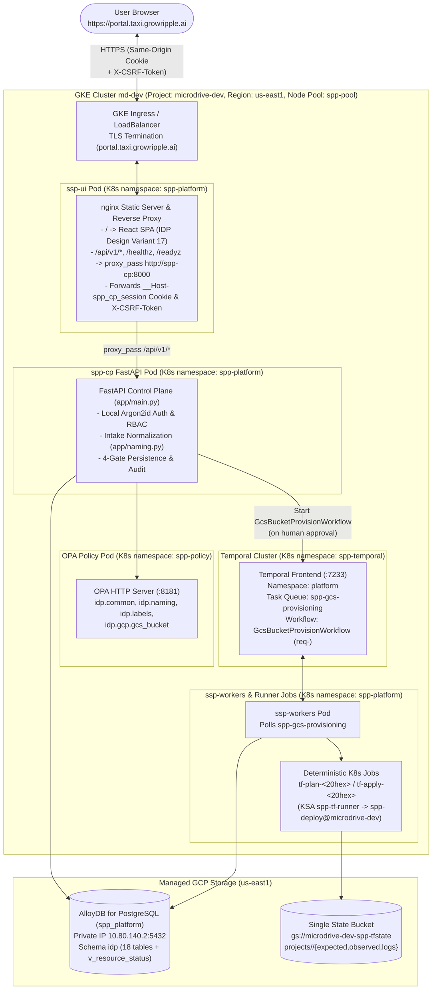

# Portal UI Experience (`ssp-ui`) — `experiences/portal-ui/`

- **Governing ADRs:**
  - [`ADR-EXP-004: Portal UI Experience (ssp-ui Storefront on IDP Design Variant 17)`](../../adr/experience/ADR-EXP-004-portal-ui-experience.md) (`Status: Proposed`)
  - [`ADR-SVC-001: First Vertical Slice — GCS Bucket (gcs_bucket) End-to-End and Guardrails`](../../adr/endpoint-service/ADR-SVC-001-first-vertical-slice-gcs-bucket.md)
  - [`ADR-SVC-002: Cloud Spanner Instance (spanner_instance) and Database (spanner_database) Specification`](../../adr/endpoint-service/ADR-SVC-002-spanner-instance-and-database.md)
  - [`ADR-GLB-002`](../../adr/global/ADR-GLB-002-languages-and-technology-stack.md), [`ADR-GLB-003`](../../adr/global/ADR-GLB-003-four-state-model.md), [`ADR-GLB-004`](../../adr/global/ADR-GLB-004-data-model-and-database.md), [`ADR-GLB-005`](../../adr/global/ADR-GLB-005-identity-and-authentication.md), [`ADR-GLB-006`](../../adr/global/ADR-GLB-006-naming-and-labeling-conventions.md), [`ADR-GLB-007`](../../adr/global/ADR-GLB-007-governance-gates-and-policy-rego.md), [`ADR-GLB-008`](../../adr/global/ADR-GLB-008-label-and-tag-standard.md), [`ADR-GLB-009`](../../adr/global/ADR-GLB-009-resource-kind-registry.md), [`ADR-BP-002`](../../adr/business-process/ADR-BP-002-build-order-and-phasing.md), [`ADR-BP-003`](../../adr/business-process/ADR-BP-003-roles-and-approver-governance.md), [`ADR-AUT-001`](../../adr/automation/ADR-AUT-001-terraform-execution-k8s-job.md), [`ADR-AUT-002`](../../adr/automation/ADR-AUT-002-day-2-operations-scope.md)
- **Companion Portal UI Docs in This Folder (Moved via `git mv`):**
  - [`16-ui-spec.md`](16-ui-spec.md) — Storefront UI visual & token specification (IDP Design Variant #17 "Shopify Polaris Infrastructure Storefront", originally at `10-product/16-ui-spec.md`).
  - [`44-ssp-ui-structure.md`](44-ssp-ui-structure.md) — `ssp-ui` repository structure and component layout notes (originally at `40-repos/44-ssp-ui-structure.md`).
- **Live Portal URL:** [`https://portal.taxi.growripple.ai`](https://portal.taxi.growripple.ai) (served by `ssp-ui` in GKE `md-dev` namespace `spp-platform`, with an **nginx reverse proxy** forwarding `/api/v1/*`, `/healthz`, and `/readyz` to `spp-cp`).
- **Visual Design Baseline:** **IDP Design Variant 17** ("Shopify Polaris Infrastructure Storefront" — storefront green `#1b7a5a`, soft-gray `#f5f6f9` canvas, white `12px`-radius cards, `Inter` + `JetBrains Mono` typography; see [`16-ui-spec.md`](16-ui-spec.md) §2).
- **Catalog Feature Status:** **Google Cloud Storage Bucket (`kind = "gcs_bucket"`, `us-east1`) is LIVE**; **Cloud Spanner (`spanner_instance`, `spanner_database`) is shown as "Coming Soon"**.
- **Submission Channel:** `channel = "ui"`, `source_ref = "portal-ui:variant-17"`.

---

## 1. Purpose & Shared Architectural Principle

The **Portal UI Experience (`ssp-ui`)** is the web-based self-service storefront for the **Self-Service Provisioning Platform (SPP)**, deployed live at **[`https://portal.taxi.growripple.ai`](https://portal.taxi.growripple.ai)** on GKE cluster `md-dev` (namespace `spp-platform`, tainted node pool `spp-pool`). Built on **IDP Design Variant 17** (React `18+`, TypeScript `5.x`, Vite, Tailwind CSS), the portal serves static assets from an **nginx** container that reverse-proxies all `/api/v1/*` requests on the same origin to the `spp-cp` (`spp-cp`) FastAPI service (`http://spp-cp.spp-platform.svc.cluster.local:8000`).

Today, the Portal UI exposes **Google Cloud Storage Bucket (`kind = "gcs_bucket"`, region `us-east1`, `nonprod`/`prod`) as a live end-to-end provisioning flow** (`form -> ssp-cp FastAPI API -> OPA intake policy -> human approval -> Temporal workflow -> Terraform plan -> apply gate`), while surfacing **Cloud Spanner (`spanner_instance` and `spanner_database`) as "Coming Soon"** in the service catalog.

### Non-Negotiable Core Principles

1. **Same `ssp-cp` API & Same Policy/Approval Path (No Privileged Channel):** The Portal UI has zero direct database credentials, zero direct OPA connections, zero direct Temporal connections, and zero cloud provisioning credentials. Every browser action goes through the nginx reverse proxy to the exact same `ssp-cp` FastAPI endpoints, OPA Rego packages (`idp.common`, `idp.naming`, `idp.labels`, `idp.gcp.gcs_bucket`), and `gcs_bucket_owner` v1 approval gate used by the Agentic Chatbot ([`../agentic-chat/`](../agentic-chat/)), MCP Server ([`../mcp/`](../mcp/)), and Client SDK ([`../sdk/`](../sdk/)).
2. **Server-Authoritative Guardrails & State:** The UI renders live bucket naming previews (`{lob}-{env}-{app}-{purpose}-{suffix}`), the **8 mandatory labels** (`LBL-001`/`LBL-002`), and the CMEK key (`projects/microdrive-dev/locations/us-east1/keyRings/spp-keyring/cryptoKeys/spp-gcs-cmek`), while `ssp-cp` and the OPA server (`http://spp-opa.spp-policy.svc.cluster.local:8181`) remain the sole authority at Gate 1 (`Requested`), Gate 2 (`Approved`), and Gate 3 (`Expected` `plan`).
3. **Human Approval Gates & No-Delete Rule Are Never Bypassed:** Submitting a bucket form in `ssp-ui` always creates a `PENDING_APPROVAL` request requiring human sign-off from `bucket_owner` (`self_approval = "deny"`). Only after human approval does `ssp-cp` dispatch **`GcsBucketProvisionWorkflow`** (`req-<request_id>`) on Temporal namespace `platform` (`task_queue = "spp-gcs-provisioning"`). Bucket deletions (`action = "delete"`) always require explicit human approval in both `nonprod` and `prod` (`AUTO_APPROVED` / `auto_approved` is forbidden).

---

## 2. GCS Bucket Validation & Guardrail Contract in the Portal UI

The GCS Bucket configuration form in `ssp-ui` (`https://portal.taxi.growripple.ai`) enforces and previews the exact contract implemented in `vaishnavi4068/ssp-cp` (`app/schemas.py`, `app/naming.py`, `app/services.py`, and `policy/gcs_bucket.rego`):

### 2.1 Form Inputs & Intake Normalization (`Stage 1: requested`)
- **APM ID (`NAM-APM-001`):** Input field validates `(?i)^APM\d{5}$` (e.g., `APM12345`) and normalizes to lowercase `^apm\d{5}$` (`apm12345`) in `metadata.apm_id` and the `sppappid` label.
- **Environment (`GLB-ENV-001`):** Selector/input normalizes `sandbox`, `dev`, `qa`, `test`, `pdev`, `pqa`, `preprod` -> **`nonprod` (no hyphen)** and `prod` -> **`prod`**. The legacy `environmentsubtype` label is **dropped and forbidden everywhere**.
- **Region (`GLB-REG-001`):** Locked to **`us-east1`** in both `nonprod` and `prod` (multi-region `"US"` is forbidden).
- **Bucket Name Preview (`GCS-NAME-001..003`, `NAM-RSV-001`):**
  - Displays `{lob}-{env}-{app}-{purpose}-{suffix}` (`<= 63` chars, lowercase).
  - Validates `{purpose}` (`2..20` char kebab-case, forbidding reserved words `non-prod`, `nonprod`, `prod`, `sandbox`, `dev`, `qa`, `test`, `pdev`, `pqa`, `preprod`, `restricted`, `unrestricted`) and blocks `goog` prefix and `google` / `g00gle` substrings (`GCS-NAME-002`).
- **8 Mandatory Labels Preview (`LBL-001` & `LBL-002`):**
  1. `sppappid`: normalized `apm_id` (`apm12345`)
  2. `costcenter`: `metadata.cost_center` (`000000`)
  3. `environmenttype`: `nonprod` | `prod` (no `environmentsubtype`)
  4. `primarylob`: lowercased `metadata.lob`
  5. `datasensitivity`: `restricted` | `unrestricted` | `internal` | `public` (`"restrict"` -> `"restricted"`)
  6. `owner`: `metadata.owner` with `[^a-z0-9_-]` replaced by `_` (`bucket_owner_example_com`)
  7. `provisionedby`: constant `"idp"`
  8. `idp_resource_id`: deterministic UUID of `idp.resource.resource_id`
  - Plus metadata-derived `dataclassification`, `sharedemailaddress`, and `tenancy`.
- **Optional Object Lifecycle Rules (`ADR-SVC-001 REQ-3`, `GCS-LFC-001..002`):** Default to **`[]` (NONE)** (no silent 365-day auto-delete). Users may optionally add `Delete` (`age_days >= 90`) or `SetStorageClass` (`NEARLINE`, `COLDLINE`, `ARCHIVE`) rules.
- **IAM Access Bindings (`GCS-IAM-001..002`):** Allows only `group:` and `serviceAccount:` members and roles in `{"roles/storage.objectAdmin", "roles/storage.objectViewer", "roles/storage.objectCreator"}`.
- **Zero Guardrail-Owned or Secret Fields (`GCS-GRD-001`, `INV-001`):** The form never allows users to override `uniform_bucket_level_access`, `public_access_prevention`, `kms_key_name`, `retention_days`, `retention_locked`, `soft_delete_retention_days`, or `force_destroy`, and rejects any secret key names (`password`, `passwd`, `client_secret`, `private_key`, `secret_value`, `api_key`, `token`).

### 2.2 Guardrail Summary & CMEK Key Displayed in the Receipt (`Stage 2: approved`)
The sticky **Infrastructure Order Summary / Guardrails Card** in Design Variant 17 displays the platform-enforced guardrails recorded in `idp.approval.guardrail_trace`:
- **`GCS-UBLA-001`:** `uniform_bucket_level_access = true`
- **`GCS-PAP-001`:** `public_access_prevention = "enforced"`
- **`GCS-ENC-001`:** `kms_key_name = "projects/microdrive-dev/locations/us-east1/keyRings/spp-keyring/cryptoKeys/spp-gcs-cmek"` (`us-east1`)
- **`GCS-RET-001`:** `retention_days = 90` (`7776000` seconds in `Expected` `tfvars`, mutually exclusive with `versioning = true`)
- **`GCS-RET-003`:** `retention_locked = false`
- **`GCS-SDP-001`:** `soft_delete_retention_days = 7` (`604800` seconds in `Expected` `tfvars`)
- **`GCS-DEL-001`:** `force_destroy = false`
- **`LBL-001`:** Merged 8 mandatory + metadata-derived + user labels
- **`PRQ-001` & `PRQ-002`:** Pre-apply lifecycle tasks `ad_group` and `vpc_sc_ingress`

---

## 3. User Journeys

### Journey 1: Local Login & Mandatory First-Login Password Rotation (`https://portal.taxi.growripple.ai`)
1. User navigates to `https://portal.taxi.growripple.ai` and signs in with their local SPP account (`manoj`, `dwayne`, `norm`, `bucket_owner`, or `requester`).
2. The browser sends `POST /api/v1/auth/login` through the nginx reverse proxy to `spp-cp`.
3. `spp-cp` verifies the Argon2id password hash, sets the `HttpOnly`, `Secure`, `SameSite=Lax` `__Host-spp_cp_session` cookie, and returns `UserProfileResponse` (`username`, `email`, `display_name`, `role`, `must_change_password`, `csrf_token`).
4. If `must_change_password == true` (first login with bootstrap password from GCP Secret Manager), the Portal UI redirects immediately to the **Change Password** screen (`POST /api/v1/auth/change-password` with `X-CSRF-Token`), rotating the password and issuing a fresh session before unlocking catalog and request screens (`ADR-GLB-005`).

### Journey 2: Storefront Catalog (GCS Bucket Live, Spanner Coming Soon) & Bucket Request Submission
1. **Storefront Home (IDP Design Variant 17):** Calls `GET /api/v1/kinds` and renders the SPP Cloud Storefront:
   - **Cloud Storage Bucket (`gcs_bucket` — GCP `us-east1`):** Badge **`LIVE`** — **Configure & Provision ->**
   - **Cloud Spanner Instance & Database (`spanner_instance`, `spanner_database` — GCP `regional-us-east1`):** Badge **`COMING SOON`** (`ADR-SVC-002` spec defined; UI checkout enabled in Phase 6).
2. **Configure GCS Bucket Form:** The requester (`requester@example.com`) enters `apm_id` (`APM12345`), `project_id` (`retail-nonprod-orders-svc`), `environment` (`dev` -> normalized to `nonprod`), `lob` (`retail`), `owner` (`bucket.owner@example.com`), `purpose_token` (`landing`), optional `lifecycle_rules` (default `[]`), and `access` bindings (`group:gcp-retail-nonprod-orders-read@example.com` -> `roles/storage.objectViewer`).
3. **Live Preview & Submit:** The right-hand **Infrastructure Order Summary** previews the normalized bucket name (`retail-nonprod-orders-landing-<4char>`), the **8 mandatory labels** (`sppappid = "apm12345"`, `environmenttype = "nonprod"`), and the CMEK key (`projects/microdrive-dev/locations/us-east1/keyRings/spp-keyring/cryptoKeys/spp-gcs-cmek`).
4. Clicking **Submit Request** calls `POST /api/v1/requests` (`channel = "ui"`, `X-CSRF-Token` header, `idempotency_key`). `ssp-cp` evaluates OPA `stage = 'requested'` and returns `201 Created` with `request_id`, `resource_id`, `approval_id`, `temporal_workflow_id = "req-<request_id>"`, and `approval.status = "PENDING"`.

### Journey 3: Approver Queue & Human Approval Gate (`gcs_bucket_owner` v1)
1. **Self-Approval Prevention in UI & API:** When `requester@example.com` views the pending approval in the **Approvals** tab (`GET /api/v1/approvals`), the **Approve** button is disabled with caption `"Self-approval is denied (ADR-BP-003: requester cannot approve their own request)"` (and `POST /api/v1/approvals/{approval_id}/decisions` enforces the same check with `403 Forbidden`).
2. **Owner / Approver Sign-Off:** When `bucket_owner` (`bucket.owner@example.com`) or an authorized `approver` (`dwayne`, `norm`, `manoj`) signs in, opens the **Approvals** queue, reviews the requested spec and `guardrail_trace`, and clicks **Approve**, the UI sends `POST /api/v1/approvals/{approval_id}/decisions` (`status = "approved"`, `comment = "..."`, `X-CSRF-Token`).
3. **OPA Stage 2 & Temporal Workflow Dispatch:** `ssp-cp` evaluates OPA `stage = 'approved'`, persists the 10-entry `guardrail_trace` and `approved_spec_sha256`, creates `pre_apply` (`ad_group`, `vpc_sc_ingress`) and `post_apply` (`notify_owner`) `idp.lifecycle_task` rows, and starts **`GcsBucketProvisionWorkflow`** (`workflow_id = "req-<request_id>"`, `namespace = "platform"`, `task_queue = "spp-gcs-provisioning"`).

### Journey 4: Four-Gate Timeline, Guardrail Trace, Runner Jobs & Drift View
1. On the **Requests** (`/requests/{request_id}`) and **Resources** (`/resources/{resource_id}`) screens (`GET /api/v1/requests/{request_id}`, `GET /api/v1/resources/{resource_id}`, `GET /api/v1/audit`), the user tracks:
   - **Gate 1 (`REQUESTED`):** Canonical `requested.document`, `requested_spec_sha256`, and OPA `stage = 'requested'` evaluation.
   - **Gate 2 (`APPROVED`):** Approver decision history, 10-entry `guardrail_trace` table (`rule_id`, `path`, `from -> to`, `reason`), `lifecycle_tasks`, and Temporal dispatch receipt (`req-<request_id>` on `spp-gcs-provisioning`).
   - **Gate 3 (`EXPECTED`):** `expected_revision_no`, `expected_revision_status`, `plan_summary` (`{add, change, destroy, replace}`), and deterministic Kubernetes Job execution (`tf-plan-<20hex>` and `tf-apply-<20hex>` in namespace `spp-platform`).
   - **Gate 4 (`OBSERVED`):** `< 2000`-byte `observed.projection` (`cloud_resource_id = "projects/_/buckets/..."`, `exists_in_cloud = true`), `sync_status` (`IN_SYNC` | `DRIFTED`), and alert-only `drift_findings` (e.g., `GCS-PAP-001` critical drift if `public_access_prevention` is altered out of band).

---

## 4. Architecture & Sequence Diagrams

### 4.1 Deployment & Proxy Architecture (`https://portal.taxi.growripple.ai`)

---

## 5. API Contract Mapping to `ssp-cp` (Real vs. Proposed Endpoints)

All requests from `ssp-ui` traverse the nginx reverse proxy (`/api/v1/*` -> `http://spp-cp.spp-platform.svc.cluster.local:8000/api/v1/*`). The table below maps each Portal UI screen/action to the verified endpoints in `vaishnavi4068/ssp-cp` (`app/main.py`):

| Portal UI Screen / Action | HTTP Method & Path (via nginx Proxy) | Status in `ssp-cp` | Auth / Role Requirement | Purpose & Response Summary |
| :--- | :--- | :--- | :--- | :--- |
| **System Health Banner** | `GET /healthz`, `GET /readyz` | **REAL** (`app/main.py:121, 143`) | Public / Internal | Displays cluster target (`microdrive-dev`, `md-dev`, `us-east1`, `spp-platform`, `temporal_namespace = "platform"`, `temporal_task_queue = "spp-gcs-provisioning"`, `default_kms_key_name`) and DB readiness. |
| **Sign-In Screen** | `POST /api/v1/auth/login` | **REAL** (`app/main.py:155`) | Public (Rate-limited, 5-attempt lockout) | Authenticates username/password with Argon2id, sets `__Host-spp_cp_session` cookie, and returns `UserProfileResponse` (`csrf_token`, `must_change_password`, `role`). |
| **First-Login Password Rotation** | `POST /api/v1/auth/change-password` | **REAL** (`app/main.py:291`) | Session + `X-CSRF-Token` | Rotates bootstrap password, sets `must_change_password = false`, and issues a new session cookie and `csrf_token`. |
| **Session Bootstrap & Top Bar User Card** | `GET /api/v1/me` | **REAL** (`app/main.py:412`) | Session Cookie | Restores logged-in user profile, persona badge (`architect`, `approver`, `bucket_owner`, `developer`), and `csrf_token` on page reload. |
| **Sign Out Button** | `POST /api/v1/auth/logout` | **REAL** (`app/main.py:359`) | Session + `X-CSRF-Token` | Revokes session in AlloyDB and clears `__Host-spp_cp_session`. |
| **Admin Account Unlock** | `POST /api/v1/auth/users/{username}/unlock` | **REAL** (`app/main.py:386`) | `architect` (`manoj`) + `X-CSRF-Token` | Clears `failed_login_attempts` and `locked_until` with an audited `reason`. |
| **Storefront Home / Catalog Grid** | `GET /api/v1/kinds` | **REAL** (`app/main.py:434`) | Active User | Loads `idp.resource_kind` rows (`gcs_bucket` rendered as **Live**, `spanner_instance` and `spanner_database` rendered as **Coming Soon**). |
| **Configure & Submit GCS Bucket** | `POST /api/v1/requests` *(alias `/api/v1/submissions`)* | **REAL** (`app/main.py:466`) | Active User + `X-CSRF-Token` | Submits `CreateRequestPayload` (`channel = "ui"`), normalizes inputs, evaluates OPA `stage = 'requested'`, and creates `PENDING_APPROVAL` rows in AlloyDB. |
| **Requests Table & Detail Drawer** | `GET /api/v1/requests` & `GET /api/v1/requests/{request_id}` | **REAL** (`app/main.py:499, 514`) | Active User | Displays 4-gate timeline, `requested.document`, `approval.guardrail_trace`, `decisions`, `lifecycle_tasks`, and `policy_evaluations`. |
| **Approvals Queue** | `GET /api/v1/approvals` & `GET /api/v1/approvals/{approval_id}` | **REAL** (`app/main.py:529, 544`) | Active User | Lists pending/decided `gcs_bucket_owner` approvals and SLA deadlines. |
| **Approve / Deny / Escalate Button** | `POST /api/v1/approvals/{approval_id}/decisions` *(aliases `/api/v1/requests/{id}/approve`, `/decisions`)* | **REAL** (`app/main.py:557`) | `approver` / `bucket_owner` / `architect` / `operations` + `X-CSRF-Token` | Enforces `self_approval = "deny"` and no `auto_approved` deletes; evaluates OPA `stage = 'approved'`; starts `GcsBucketProvisionWorkflow` (`req-<request_id>`) on `spp-gcs-provisioning`. |
| **Resources & Drift Inventory** | `GET /api/v1/resources` (`/api/v1/status`) & `GET /api/v1/resources/{resource_id}` | **REAL** (`app/main.py:649, 658`) | Active User | Queries `idp.v_resource_status`, `< 2000`-byte `idp.resource_observed.projection`, `open_drift_count`, and `drift_findings`. |
| **Project State Unit Kill Switch** | `POST /api/v1/state-units/{state_unit_id}/freeze` & `/unfreeze` | **REAL** (`app/main.py:710, 744`) | Approver / Operations + `X-CSRF-Token` | Freezes or unfreezes a project's state unit (`INV-9`). |
| **Audit & Policy Log Viewer** | `GET /api/v1/audit` | **REAL** (`app/main.py:784`) | Active User | Displays `gate_events`, `audit_logs`, and `policy_evaluations`. |
| **Server Dry-Run Preflight & Plan Detail** | `POST /api/v1/agent/workflows/validate` & `GET /api/v1/requests/{request_id}/plan` | **PROPOSED** (`ADR-AUT-004`, `ADR-EXP-004`) | Active User | Optional server-side dry-run preview prior to submit and dedicated Terraform `plan_summary` / runner Job log view. |

---

## 6. Security & Identity (Including Current Local Login — `ADR-GLB-005`)

1. **Same-Origin nginx Reverse Proxy & Hardened Session Cookies:**
   - Because `ssp-ui` serves the frontend and proxies `/api/v1/*` from the same origin (`https://portal.taxi.growripple.ai`), the `__Host-spp_cp_session` cookie (`HttpOnly`, `Secure`, `SameSite=Lax`, `Path=/`) is never exposed to JavaScript (`document.cookie` cannot read it) and never crosses third-party origins.
2. **CSRF Protection on Every Mutating Call:**
   - The client stores `csrf_token` from `POST /api/v1/auth/login` / `GET /api/v1/me` in memory only and attaches `X-CSRF-Token` on all `POST`, `PUT`, `PATCH`, and `DELETE` requests (`app/auth.py:306-313`).
3. **Bootstrap Users & Mandatory First-Login Password Rotation:**
   - Seeded accounts (`manoj` [`architect`], `dwayne` [`approver`], `norm` [`approver`], `bucket_owner` [`bucket_owner`], `requester` [`developer`]) read initial bootstrap passwords from GCP Secret Manager (`spp-cp-bootstrap-*`) hashed with Argon2id (`time_cost=2, memory_cost=65536, parallelism=2`).
   - While `must_change_password == true`, `ssp-cp` returns `403 Forbidden` on all control-plane endpoints (`ADR-GLB-005 GR-4`), and the UI locks navigation to the password-rotation form.
   - Rate limiting (10 attempts / 60s window per IP and username) and automatic 15-minute lockout after 5 consecutive failed attempts (`423 Locked`) are enforced by `ssp-cp`.
4. **Future Corporate SSO Upgrade Path:**
   - Per `ADR-GLB-005 REQ-5`, transitioning to corporate OIDC/SAML SSO will preserve the exact same RBAC roles and `/api/v1/me` contract.

---

## 7. Approval & No-Delete Rules (`ADR-BP-003`, `ADR-GLB-007`)

- **Mandatory Human Approval (`gcs_bucket_owner` v1):** Every bucket request submitted from the Portal UI enters `PENDING_APPROVAL` and waits for `bucket_owner` (`/metadata/owner`).
- **Self-Approval Denial (`self_approval = "deny"`):** The Portal UI disables the **Approve** button when the logged-in user matches `requested_by` / `submitted_by`, and `ssp-cp` rejects self-approval with `403 Forbidden`.
- **Universal Human Approval for All Deletes & Destructive Plans:**
  - Triggering a bucket deletion (`action = "delete"`) in the Portal UI requires a confirmation modal with typed resource name confirmation and submits a new `delete` request referencing `base_approval_id`.
  - `AUTO_APPROVED` / `auto_approved` is strictly forbidden on all `delete` requests and any plan with `destroy > 0` or `replace > 0` in **both `nonprod` and `prod`**.
  - `force_destroy` is permanently `false` (`GCS-DEL-001`), and `retention_locked` is permanently `false` (`GCS-RET-003`).

---

## 8. Observability & Audit

- Every Portal UI action records an immutable row in `idp.cp_audit_log` (`actor_username`, `actor_role`, `source_ip` resolved across trusted GKE LB hops via `get_client_ip()`, `action_type`, `resource_id`, `request_id`, `approval_id`, `reason`) and `idp.gate_event` (`request.submitted`, `approval.granted`, `approval.denied`, `state_unit.frozen`, `state_unit.unfrozen`).
- The Portal UI **Audit** tab (`GET /api/v1/audit`) surfaces all three audit streams (`gate_events`, `audit_logs`, `policy_evaluations`) with SHA-256 hash chain values (`raw_payload_sha256 -> requested_spec_sha256 -> approved_spec_sha256 -> projection_sha256`).

---

## 9. MVP Scope (Live Today) vs. Later Phases

| Capability | MVP Scope (Live Today at `https://portal.taxi.growripple.ai`) | Later Phases (Phase 5 Full Template Engine & Phase 6+ Multi-Kind) |
| :--- | :--- | :--- |
| **Visual Baseline** | **IDP Design Variant 17** ("Shopify Polaris Infrastructure Storefront", React + Vite + Tailwind CSS behind nginx proxy to `spp-cp`) | Full `@ssp/form-renderer` dynamic bundle loader + embedded Jev model Sidekick slide-over drawer ([`16-ui-spec.md`](16-ui-spec.md)) |
| **Catalog Services** | **GCS Bucket (`gcs_bucket` in `us-east1`) LIVE**; **Cloud Spanner (`spanner_instance`, `spanner_database`) shown as "Coming Soon"** | Enable live Cloud Spanner instance + database provisioning (`WI-007`, `ADR-SVC-002`), GCE VM, AlloyDB/Cloud SQL, BigQuery dataset |
| **Authentication** | Local Argon2id login (`POST /api/v1/auth/login`), first-login password rotation, `__Host-spp_cp_session` cookie + `X-CSRF-Token` | Corporate OIDC / SAML SSO (`ADR-GLB-005`) |
| **4-Gate & Approval Flow** | Live `POST /api/v1/requests` -> `gcs_bucket_owner` approval queue -> `GcsBucketProvisionWorkflow` dispatch -> 4-gate status, `guardrail_trace`, `< 2 KB` Observed projection, and audit log viewer | Live SSE log tailing of `tf-plan-<20hex>` / `tf-apply-<20hex>` Jobs and interactive Day-2 drift remediation wizard |

---

## 10. Open Questions

- [ ] **OQ-EXP-UI-1 (Spanner Checkout Activation in `ssp-ui` — [Owner: Manoj / Dwayne]):** Confirm the cutover milestone (`WI-007`) for flipping the **Cloud Spanner (`spanner_instance`, `spanner_database`)** catalog card in `https://portal.taxi.growripple.ai` from **Coming Soon** to **Live** once `ssp-module-spanner` and `ssp-cp` Spanner OPA policies are verified end-to-end.
- [ ] **OQ-EXP-UI-2 (Embedding Jev Model Chat Drawer in Portal Variant 17 — [Owner: Dwayne / Manoj]):** Confirm mounting the Jev model Agentic Chat slide-over ([`../agentic-chat/`](../agentic-chat/)) inside the bottom composer / right drawer of `https://portal.taxi.growripple.ai` ([`16-ui-spec.md`](16-ui-spec.md) §4.7).
