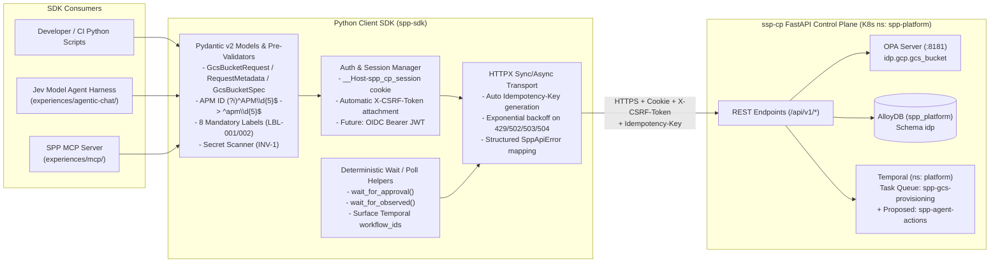

# Client SDK Experience (`spp-sdk`) — `experiences/sdk/`

- **Governing ADRs:**
  - [`ADR-EXP-003: Client SDK Experience (Python First, TypeScript Later)`](../../adr/experience/ADR-EXP-003-client-sdk-experience.md) (`Status: Proposed`)
  - [`ADR-AUT-004: Agent Harness ("Jev Model") and Deterministic Temporal Workflow Execution Layer`](../../adr/automation/ADR-AUT-004-agent-harness-and-temporal-workflow-execution.md) (`Status: Proposed`)
  - [`ADR-SVC-001: First Vertical Slice — GCS Bucket (gcs_bucket) End-to-End and Guardrails`](../../adr/endpoint-service/ADR-SVC-001-first-vertical-slice-gcs-bucket.md)
  - [`ADR-GLB-002`](../../adr/global/ADR-GLB-002-languages-and-technology-stack.md), [`ADR-GLB-003`](../../adr/global/ADR-GLB-003-four-state-model.md), [`ADR-GLB-004`](../../adr/global/ADR-GLB-004-data-model-and-database.md), [`ADR-GLB-005`](../../adr/global/ADR-GLB-005-identity-and-authentication.md), [`ADR-GLB-006`](../../adr/global/ADR-GLB-006-naming-and-labeling-conventions.md), [`ADR-GLB-007`](../../adr/global/ADR-GLB-007-governance-gates-and-policy-rego.md), [`ADR-GLB-008`](../../adr/global/ADR-GLB-008-label-and-tag-standard.md), [`ADR-BP-003`](../../adr/business-process/ADR-BP-003-roles-and-approver-governance.md), [`ADR-AUT-001`](../../adr/automation/ADR-AUT-001-terraform-execution-k8s-job.md)
- **First Feature Covered:** Google Cloud Storage Bucket (`kind = "gcs_bucket"`, region `us-east1`, environments `nonprod` and `prod` only).
- **Primary Language (MVP):** **Python `3.11+` (`spp-sdk`)** using `Pydantic v2` and `httpx` (synchronous `SppClient` and asynchronous `AsyncSppClient`).
- **Secondary Language (Phase 5 Later):** **TypeScript `5.x` (`@spp/sdk`)** generated from the `ssp-cp` OpenAPI 3.1 contract alongside `ssp-ui` (`ADR-BP-002` Phase 5).
- **Submission Channel:** `channel = "api"` (configurable to `"chat"` when embedded inside the Jev model Agent Harness or MCP Server), `source_ref = "sdk:python/<version>"`.

---

## 1. Purpose & Shared Architectural Principle

The **Client SDK Experience (`spp-sdk`)** provides a strongly typed, idiomatic **Python client SDK** (with a **TypeScript SDK (`@spp/sdk`)** planned for Phase 5 when `ssp-ui` is built) over the **`ssp-cp` FastAPI REST API**. It serves two roles:
1. **Direct Programmatic & CI/CD Consumption:** Enables platform engineers, application teams, and integration tests to validate, submit, inspect, and poll GCS bucket requests and human approvals without hand-crafting HTTP sessions, CSRF headers, or retry loops.
2. **Shared Transport Foundation for Agentic Chat & MCP (`ADR-AUT-004`):** Both the **Jev model Agent Harness** ([`../agentic-chat/`](../agentic-chat/)) and the **MCP Server** ([`../mcp/`](../mcp/)) use `spp-sdk` as their underlying client library to invoke deterministic Temporal workflows on namespace `platform` via `ssp-cp`.

### Non-Negotiable Core Principles

1. **Same `ssp-cp` API & Same Policy/Approval Path (No Privileged Path):** `spp-sdk` communicates exclusively with the `ssp-cp` FastAPI REST API (`/api/v1/*`). It never connects directly to AlloyDB (`spp_platform`), the OPA sidecar (`:8181`), the Temporal server (`:7233`), Kubernetes APIs, or the GCS state bucket (`gs://microdrive-dev-spp-tfstate`).
2. **Client-Side Pre-Validation Mirrors `ssp-cp` & OPA (`ADR-SVC-001`):** Typed Pydantic v2 models (`GcsBucketRequest`, `RequestMetadata`, `GcsBucketSpec`, `AccessBinding`, `LifecycleRule`) validate and normalize inputs client-side before sending a network call—enforcing APM ID format `(?i)^APM\d{5}$` -> lowercase `^apm\d{5}$`, `environment` -> `nonprod` | `prod` (no `environmentsubtype`), `location == "us-east1"`, bucket naming rules (`GCS-NAME-001..002`, `NAM-RSV-001`), the **8 mandatory labels** (`LBL-001`/`LBL-002`), CMEK key preview (`projects/microdrive-dev/locations/us-east1/keyRings/spp-keyring/cryptoKeys/spp-gcs-cmek`), and secret scanning (`INV-1`)—while `ssp-cp` and OPA remain the authoritative server-side gate.
3. **Human Approval Gates & No-Delete Rule Are Never Bypassed:** `spp-sdk` cannot bypass `gcs_bucket_owner` v1, cannot self-approve (`self_approval = "deny"`), and rejects `status = "auto_approved"` on any `delete` request in both `nonprod` and `prod`.Wait helpers (`wait_for_approval`, `wait_for_observed`) poll `ssp-cp` and surface Temporal `workflow_id`s (`req-<request_id>`, `apr-<request_id>`, `su-gcp-<project_id>`) while waiting for a human approver and deterministic Kubernetes Jobs (`tf-plan-<20hex>`, `tf-apply-<20hex>`).

---

## 2. User Journeys

### Journey 1: Python Developer Validates, Submits, and Waits for a GCS Bucket
```python
from spp_sdk import (
    AccessBinding,
    GcsBucketRequest,
    GcsBucketSpec,
    RequestMetadata,
    SppClient,
)

with SppClient(base_url="https://spp-cp.internal") as client:
    # 1. Authenticate via local Argon2id credentials (manages __Host-spp_cp_session + X-CSRF-Token)
    profile = client.login(username="requester", password="<from-secret-manager-or-vault>")
    assert not profile.must_change_password

    # 2. Construct typed GCS bucket request (validates & normalizes client-side)
    req = GcsBucketRequest(
        action="create",
        idempotency_key="orders-landing-v1",
        metadata=RequestMetadata(
            apm_id="APM12345",                          # Normalized to 'apm12345' (sppappid label)
            project_id="retail-nonprod-orders-svc",
            environment="dev",                          # Normalized to 'nonprod' (no hyphen)
            lob="retail",
            data_sensitivity="restrict",                # Normalized to 'restricted'
            data_classification="proprietary",
            owner="bucket.owner@example.com",           # Normalized in label to 'bucket_owner_example_com'
            shared_mailbox="retail-orders-team@example.com",
            cost_center="000000",
            tenancy="dedicated",
            labels={"app": "orders"},
        ),
        spec=GcsBucketSpec(
            purpose_token="landing",
            purpose="Landing zone for order events",
            location="us-east1",                        # Locked to us-east1
            storage_class="STANDARD",
            versioning=False,
            lifecycle_rules=[],                         # Defaults to [] (NONE) per ADR-SVC-001 REQ-3
            access=[
                AccessBinding(
                    role="roles/storage.objectViewer",
                    members=["group:gcp-retail-nonprod-orders-read@example.com"],
                )
            ],
        ),
    )

    # 3. Preview the 8 mandatory labels & CMEK guardrail locally or via dry-run validate workflow
    labels_preview = req.compute_canonical_labels(resource_id="<pending-uuid>")
    # Contains: sppappid='apm12345', costcenter='000000', environmenttype='nonprod',
    # primarylob='retail', datasensitivity='restricted', owner='bucket_owner_example_com',
    # provisionedby='idp', idp_resource_id='<pending-uuid>' (no environmentsubtype)

    # 4. Submit request to ssp-cp (POST /api/v1/requests)
    detail = client.requests.submit(req)
    print(f"Submitted request_id={detail.request_id}, workflow_id={detail.temporal_workflow_id}")
    print(f"Pending human approval: approval_id={detail.approval.approval_id} (gate={detail.approval.gate_key})")

    # 5. Wait for human approval (blocks/polls until bucket_owner approves via Portal/CLI)
    approved = client.requests.wait_for_approval(detail.request_id, timeout_seconds=3600)
    print(f"Approved! Guardrails applied: {[g.rule_id for g in approved.approval.guardrail_trace]}")
    print(f"Dispatched Temporal workflow: {approved.temporal_workflow_dispatch.workflow_id}")

    # 6. Wait for Gate 4 (OBSERVED) completion in gs://microdrive-dev-spp-tfstate
    resource = client.resources.wait_for_observed(detail.resource_id, timeout_seconds=600)
    print(f"Provisioned in GCP: {resource.observed.cloud_resource_id} (gate={resource.status.gate})")
```

### Journey 2: Approver Persona Reviews & Approves a Pending Request via SDK / CLI
```python
with SppClient(base_url="https://spp-cp.internal") as owner_client:
    owner_client.login(username="bucket_owner", password="<from-secret-manager-or-vault>")

    pending = owner_client.approvals.list(status="PENDING")
    for item in pending:
        # Inspect request details and verify guardrail trace before deciding
        result = owner_client.approvals.decide(
            approval_id=item.approval_id,
            status="approved",
            comment="Approved GCS landing bucket for APM12345 in us-east1",
        )
        # ssp-cp runs OPA stage='approved', injects CMEK projects/microdrive-dev/locations/us-east1/keyRings/spp-keyring/cryptoKeys/spp-gcs-cmek,
        # and starts Temporal workflow GcsBucketProvisionWorkflow (id="req-<request_id>", queue="spp-gcs-provisioning")
```

---

## 3. Architecture Diagram



---

## 4. API Contract Mapping to `ssp-cp` (Real vs. Proposed Endpoints)

Every method in `spp-sdk` maps directly to `vaishnavi4068/ssp-cp` (`app/main.py` and `app/schemas.py`), clearly distinguishing **existing (`REAL`)** endpoints from **proposed (`PROPOSED`)** extensions:

| SDK Method (`SppClient` / `AsyncSppClient`) | HTTP Method & Path | Status in `ssp-cp` | Request / Response Models (`spp_sdk.models`) | Notes & Temporal Workflow Mapping |
| :--- | :--- | :--- | :--- | :--- |
| `client.healthz()` / `client.readyz()` | `GET /healthz`, `GET /readyz` | **REAL** (`app/main.py:121, 143`) | `HealthResponse`, `ReadyResponse` | Returns cluster target (`gcp_project = "microdrive-dev"`, `region = "us-east1"`, `temporal_namespace = "platform"`, `temporal_task_queue = "spp-gcs-provisioning"`, `default_kms_key_name`). |
| `client.login(username, password)` | `POST /api/v1/auth/login` | **REAL** (`app/main.py:155`) | `LoginRequest` -> `UserProfileResponse` | Stores `__Host-spp_cp_session` cookie and caches `csrf_token` for subsequent mutating requests. |
| `client.change_password(current_password, new_password)` | `POST /api/v1/auth/change-password` | **REAL** (`app/main.py:291`) | `ChangePasswordRequest` -> `UserProfileResponse` | Rotates first-login bootstrap password (`must_change_password: true -> false`) and refreshes session + `csrf_token`. |
| `client.logout()` | `POST /api/v1/auth/logout` | **REAL** (`app/main.py:359`) | `dict` (`{"status": "logged_out"}`) | Revokes session in AlloyDB (`cp_sessions.revoked = true`). |
| `client.me()` | `GET /api/v1/me` | **REAL** (`app/main.py:412`) | `UserProfileResponse` | Returns current user profile, `role`, `must_change_password`, and `csrf_token`. |
| `client.kinds.list()` | `GET /api/v1/kinds` | **REAL** (`app/main.py:434`) | `list[ResourceKindInfo]` | Queries `idp.resource_kind` (`gcs_bucket`, `spanner_instance`, `spanner_database`). |
| `client.requests.validate(req)` | `POST /api/v1/agent/workflows/validate` *(or local + server dry-run)* | **PROPOSED** (`ADR-AUT-004`, `ADR-EXP-003`) | `GcsBucketRequest` -> `ValidationResult` | Executes `AgentValidateRequestWorkflow` (`wf-val-*` on `platform`) returning `guardrail_trace`, 8 mandatory labels, CMEK key, and `preview_sha256`. |
| `client.requests.submit(req)` | `POST /api/v1/requests` *(alias `/api/v1/submissions`)* | **REAL** (`app/main.py:466`) | `GcsBucketRequest` -> `RequestDetail` | Sends `CreateRequestPayload` with `X-CSRF-Token` and `idempotency_key`; returns `request_id`, `resource_id`, `approval_id`, `req-<request_id>`, and `apr-<request_id>`. |
| `client.requests.get(request_id)` | `GET /api/v1/requests/{request_id}` | **REAL** (`app/main.py:514`) | `RequestDetail` | Returns `requested`, `submission`, `resource`, `approval` (`guardrail_trace`, `decisions`, `lifecycle_tasks`), and `policy_evaluations`. |
| `client.requests.list(kind=None, status=None)` | `GET /api/v1/requests` | **REAL** (`app/main.py:499`) | `list[RequestDetail]` | Lists requests ordered by `submitted_at DESC`. |
| `client.requests.get_plan(request_id)` | `GET /api/v1/requests/{request_id}/plan` | **PROPOSED** (`ADR-AUT-004`, `ADR-EXP-003`) | `PlanSummaryDetail` | Executes `AgentGetPlanWorkflow` (`wf-pln-*`) to return `idp.expected_revision.plan_summary` (`{add, change, destroy, replace}`) and `idp.tf_operation` (`k8s_job_name`). |
| `client.approvals.list(status=None)` | `GET /api/v1/approvals` | **REAL** (`app/main.py:529`) | `list[ApprovalSummary]` | Lists approvals filtered by status (`PENDING`, `APPROVED`, `DENIED`). |
| `client.approvals.get(approval_id)` | `GET /api/v1/approvals/{approval_id}` | **REAL** (`app/main.py:544`) | `RequestDetail` | Accepts either `approval_id` or `request_id`. |
| `client.approvals.decide(approval_id, status, comment)` | `POST /api/v1/approvals/{approval_id}/decisions` *(aliases `/api/v1/requests/{id}/approve`, `/decisions`)* | **REAL** (`app/main.py:557`) | `ApprovalDecisionInput` -> `RequestDetail` | Enforces `self_approval = "deny"` and no `auto_approved` deletes; evaluates OPA `stage = 'approved'`; starts `GcsBucketProvisionWorkflow` (`req-<request_id>`) on `spp-gcs-provisioning`. |
| `client.resources.list()` / `client.resources.get(resource_id)` | `GET /api/v1/resources` (`/api/v1/status`), `GET /api/v1/resources/{resource_id}` | **REAL** (`app/main.py:649, 658`) | `list[ResourceStatusRow]`, `ResourceDetail` | Reads `idp.v_resource_status`, `< 2000`-byte `idp.resource_observed.projection`, and `idp.drift_finding`. |
| `client.state_units.freeze(id, reason)` / `unfreeze(id, reason)` | `POST /api/v1/state-units/{state_unit_id}/freeze` & `/unfreeze` | **REAL** (`app/main.py:710, 744`) | `StateUnitFreezeRequest` -> `StateUnitStatus` | Per-project kill switch (`INV-9`). |
| `client.audit.list(resource_id=None, request_id=None, limit=100)` | `GET /api/v1/audit` | **REAL** (`app/main.py:784`) | `AuditBundleResponse` | Returns `gate_events`, `audit_logs`, and `policy_evaluations`. |

---

## 5. Typed Models, Error Handling & Versioning

### 5.1 Typed GCS Bucket Request Models (`spp_sdk.models`)
The SDK shares the exact validation logic from `ssp-cp/app/schemas.py` and `ssp-cp/app/naming.py`:
- **`RequestMetadata` (`extra = "forbid"`):**
  - Validates `apm_id` against `(?i)^APM\d{5}$` and normalizes to lowercase `^apm\d{5}$` (`NAM-APM-001`).
  - Validates `environment` and normalizes `sandbox | dev | qa | test | pdev | pqa | preprod` -> `nonprod` or `prod` (`GLB-ENV-001`).
  - Rejects `environmentsubtype` in `labels` (`LBL-001`).
  - Provides `compute_canonical_labels(resource_id)` returning all **8 mandatory labels** (`sppappid`, `costcenter`, `environmenttype`, `primarylob`, `datasensitivity`, `owner`, `provisionedby`, `idp_resource_id`) + metadata-derived labels (`dataclassification`, `sharedemailaddress`, `tenancy`).
- **`GcsBucketSpec`:**
  - Enforces `location == "us-east1"` (`GLB-REG-001`).
  - Defaults `lifecycle_rules` to `[]` (NONE) (`ADR-SVC-001 REQ-3`) and validates optional `Delete` (`age_days >= 90`) and `SetStorageClass` rules (`GCS-LFC-001..002`).
  - Validates `access` entries: only `group:` and `serviceAccount:` members (`GCS-IAM-001`) and roles in `{"roles/storage.objectAdmin", "roles/storage.objectViewer", "roles/storage.objectCreator"}` (`GCS-IAM-002`).
  - Rejects guardrail-owned fields (`uniform_bucket_level_access`, `public_access_prevention`, `kms_key_name`, `default_kms_key_name`, `retention_days`, `retention_locked`, `soft_delete_retention_days`, `force_destroy`) at request construction time (`GCS-GRD-001`).
  - Exposes constant `DEFAULT_CMEK_KEY_URI = "projects/microdrive-dev/locations/us-east1/keyRings/spp-keyring/cryptoKeys/spp-gcs-cmek"` (`GCS-ENC-001`).

### 5.2 Wait / Poll Helpers (`client.requests.wait_for_*`)
- `client.requests.wait_for_approval(request_id, poll_interval_seconds=5.0, timeout_seconds=3600.0)`: Polls `GET /api/v1/requests/{request_id}` with jittered backoff until `approval.status` transitions out of `"PENDING"` (`"APPROVED"` returns `RequestDetail`; `"DENIED"` or `"EXPIRED"` raises `SppApprovalDeniedError`).
- `client.resources.wait_for_observed(resource_id, poll_interval_seconds=5.0, timeout_seconds=600.0)`: Polls `GET /api/v1/resources/{resource_id}` until `status.gate == "OBSERVED"` and `status.sync_status == "IN_SYNC"` (or raises `SppProvisioningFailedError` if `sync_status == "FAILED"` or `expected_revision_status == "BLOCKED"`).

### 5.3 Structured Error Hierarchy (`spp_sdk.errors`)
- `SppError` (base exception)
  - `SppAuthenticationError` (`401 Unauthorized` / `423 Locked`)
  - `SppPasswordChangeRequiredError` (`403 Forbidden` with `must_change_password`)
  - `SppAuthorizationError` (`403 Forbidden`, including `self_approval = "deny"` and forbidden `auto_approved` on deletes)
  - `SppPolicyViolationError` (`422 Unprocessable Entity` from OPA/schema validation; exposes `.rule_id`, `.violations: list[PolicyViolation]`, and `.stage`)
  - `SppConflictError` (`409 Conflict`, e.g., `GCS-NAME-003` bucket name collision or sequential approval phase out-of-order)
  - `SppRateLimitError` (`429 Too Many Requests`)

### 5.4 Versioning & Compatibility Strategy
- **Semantic Versioning (`MAJOR.MINOR.PATCH`):** `spp-sdk` versions track `ssp-cp` API schema versions (`api_version = "idp.spp/v1"`, `gcs_bucket` `schema_version = "1.0.0"`).
- **Additive Evolution:** Minor versions (`1.x.0`) add new resource kinds (e.g., `SpannerInstanceRequest`, `SpannerDatabaseRequest` in Phase 6) or optional fields without breaking existing `GcsBucketRequest` callers.
- **TypeScript SDK (`@spp/sdk` — Phase 5 Later):** When `ssp-ui` is built in Phase 5 (`ADR-BP-002`, `WI-006`), `@spp/sdk` will be generated from `ssp-cp`'s FastAPI `/openapi.json` schema using `openapi-typescript`, sharing identical endpoint paths, CSRF handling, and error codes.

---

## 6. Security & Identity (`ADR-GLB-005`)

1. **Session & CSRF Management:** On `client.login()`, `spp-sdk` stores the `HttpOnly` `__Host-spp_cp_session` cookie inside the `httpx.Client` cookie jar and automatically attaches `X-CSRF-Token: <csrf_token>` on all `POST`, `PUT`, `PATCH`, and `DELETE` requests.
2. **Pluggable Bearer Token Auth (Future SSO):** `SppClient(base_url=..., bearer_token=...)` also accepts an OIDC/SSO Bearer token for seamless migration once corporate SSO is enabled (`ADR-GLB-005 REQ-5`).
3. **Zero Secrets in Code or Payloads (`INV-1`):** `spp-sdk` never reads or accepts GCP service account JSON keys and runs `scan_for_secrets()` inside `GcsBucketRequest` validation before any HTTP request leaves the client.

---

## 7. Approval & No-Delete Rules (`ADR-BP-003`, `ADR-GLB-007`)

- `client.approvals.decide()` validates client-side that `status` is in `{"approved", "denied", "escalated"}` and **forbids `"auto_approved"`** on any delete request.
- If a caller attempts to approve a request where their authenticated `UserProfileResponse.email` or `username` matches `request.requested_by`, `spp-sdk` raises `SppAuthorizationError("self_approval='deny': requester cannot approve their own request (ADR-BP-003)")` before even making the network round-trip (and `ssp-cp` enforces the same check server-side).

---

## 8. Observability & Audit

- Every request sent by `spp-sdk` includes:
  - `User-Agent: spp-sdk-python/<version>`
  - `X-Request-Id: <uuid4>` (propagated into OpenTelemetry spans and `idp.cp_audit_log`)
  - `Idempotency-Key` (automatically populated on `submit()` and persisted in `idp.submission.idempotency_key` under `UNIQUE (apm_id, idempotency_key)`).
- Optional OpenTelemetry instrumentation (`spp_sdk.telemetry.instrument()`) injects W3C `traceparent` headers into every `ssp-cp` request.

---

## 9. MVP Scope vs. Later Phases

| Feature | MVP Scope (Current — Phase 3/4) | Later Scope (Phase 5 & Phase 6) |
| :--- | :--- | :--- |
| **Language** | **Python `3.11+` (`spp-sdk`)** (`SppClient` & `AsyncSppClient`) | **TypeScript `5.x` (`@spp/sdk`)** for `ssp-ui` (`WI-006`) |
| **Resource Models** | `GcsBucketRequest` (`create`, `update`, `delete` in `us-east1`) | `SpannerInstanceRequest`, `SpannerDatabaseRequest` (`ADR-SVC-002`), VM, BigQuery dataset |
| **Auth** | Local Argon2id login + `__Host-spp_cp_session` + `X-CSRF-Token` | Corporate OIDC / SAML token exchange & Workload Identity token federation |
| **CLI Wrapper** | Optional `spp-cli` thin entry point over `spp-sdk` | Full interactive CLI with SSE event streaming |

---

## 10. Open Questions

- [ ] **OQ-EXP-SDK-1 (Package Hosting Location — [Owner: Manoj / Norm]):** Confirm whether `spp-sdk` lives in a dedicated repository (`github.com/vaishnavi4068/ssp-sdk`), inside `ssp-cp/sdk/python/`, or is published to GCP Artifact Registry Python repository (`us-east1-python.pkg.dev/microdrive-dev/spp-python/spp-sdk`).
- [ ] **OQ-EXP-SDK-2 (TypeScript SDK Generation Timing — [Owner: Dwayne / Manoj]):** Confirm that `@spp/sdk` (TypeScript) remains deferred to Phase 5 (`ADR-BP-002`, `WI-006`) alongside `ssp-ui`.
